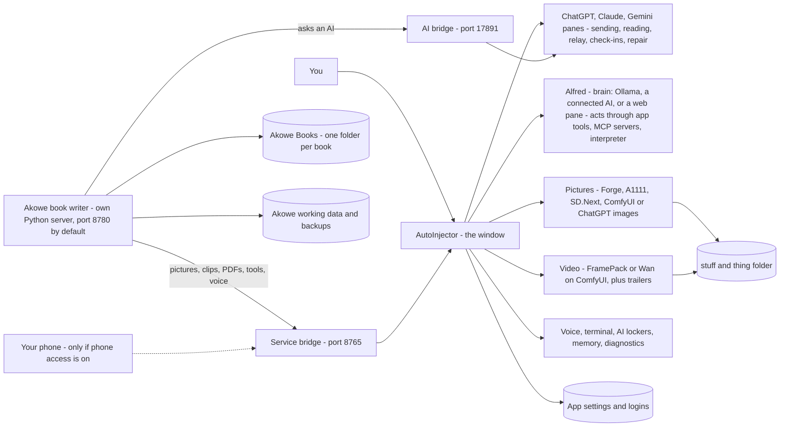

# How AutoInjector works

This page explains how the whole program fits together and what happens behind the buttons. It is not a
button-by-button manual. For that, see [`README.md`](../README.md), [`akowe/README.md`](../akowe/README.md) and
[`docs/ALFRED.md`](ALFRED.md). For what changed and when (and how to undo a change), see
[`PROJECT_HISTORY.md`](PROJECT_HISTORY.md).

## 1. The big picture

AutoInjector is one window on your PC. Inside it, ChatGPT, Claude and Gemini each run in their own pane. These are
the real websites, signed in with your own subscriptions, so there are no API bills. AutoInjector types into those
panes and reads the replies, just as you would. Next to them sits **Akọwe**, the book writer. Akọwe is a small
program on your PC, shown in the 📖 Akọwe tab. When Akọwe needs an AI, it asks AutoInjector through a private
connection called **the bridge**. AutoInjector also drives a picture program (Forge, A1111, SD.Next or ComfyUI,
or ChatGPT's own image maker) and **FramePack** or **Wan** for video, on your own graphics card. **🎩 Alfred** is an
assistant that can press the app's buttons for you. He thinks with a local AI (Ollama), an AI you connect with a
key, or one of the web panes. Pictures, videos, models and logs go into **"stuff and thing"**. Books, Akọwe's own
data and the app's settings each have their own place (see section 6).



The same picture in plain text:

```
YOU
 |
 v
AUTOINJECTOR (the window)
 |
 +-- ChatGPT / Claude / Gemini panes
 |     sending, reading, relay between AIs, queues, House Rules,
 |     prompt sequences, attachments, transcripts, check-ins and repair
 |
 +-- 📖 Akọwe tab --> Akọwe's own Python server (port 8780 by default; 8781-8799 if busy)
 |
 +-- 🎩 Alfred
 |     brain: Ollama, OR an AI you connect with a key, OR a web pane
 |     acts through: the app's own tools, MCP tool servers, the code interpreter
 |
 +-- 🎨 Pictures: Forge / A1111 / SD.Next / ComfyUI, OR ChatGPT's image maker
 |
 +-- 🎬 Video: FramePack, OR Wan on ComfyUI  + trailer assembly
 |
 +-- Voice, terminal, AI lockers, memory, diagnostics
 |
 +-- AI bridge (17891)       <--> Akọwe's AI requests and answers
 |
 +-- Service bridge (8765)   <--> pictures, video, trailers, PDFs, tools, voice,
                                  messages, events, and the phone page

AKỌWE (the book writer)
 |
 +-- Idea, characters, world, plot, outline, chapters
 +-- Book Bible, dossiers, continuity and quality checks
 +-- Reviews, rewrites, approvals, reports, backups
 +-- PDF / EPUB / Word exports and the book.akowe file
```

"Port" just means a numbered door on your own PC. The numbers above are the usual ones, not fixed: if a door
is taken, Akọwe tries the next few (8781–8799), and each door can be set to another number. The doors open only to
your own computer (`127.0.0.1`), never to the internet, unless you turn on **phone access**. That opens the service
bridge to your home Wi-Fi, behind its key.

## 2. The parts

### 🤖 AutoInjector (the window)

- **What it is:** the desktop app you start. Folder: `desktop-app/`.
- **Panes:** each AI's real website, side by side. You sign in once; the sites remember you.
- **Typing and reading:** to send a message, AutoInjector types it into the AI's message box and presses Send.
  Every message starts with a number, `[MSG #n]`. A send only counts when that number shows up in the chat.
- **Tags:** each AI is asked to start its reply with `[TO: …]` (who it is for) and end with `[FROM: …]` (who wrote
  it). The closing tag tells AutoInjector the reply is finished. Then it reads the reply.
- **Relay:** a reply marked `[TO: CLAUDE]` is passed on to Claude, and so on. This lets the AIs talk to each other.
  After 30 hand-offs in a row it pauses until you step in.
- **Check-ins and self-repair:** about every 20 minutes, AutoInjector sends each idle AI a tiny test ("Reply with
  only this word: marigold"). They stay out of the app's conversation and are never passed to the other AIs,
  though you may spot them in that AI's own pane. If the AI fails, AutoInjector works out why and tries to fix it:
  other ways to find the box or the reply, a page reload, pressing Stop on a stuck AI. If an AI was busy with
  something, it is then asked to carry on where it left off.
  - **Slow is not broken:** each AI's wait follows how long its check-ins really take (Gemini usually answers in
    about 16 seconds but sometimes takes over 2 minutes), and while a reply is still being written the wait goes on,
    up to 3 minutes. Stop is only pressed when the reply has not changed for a while. An answer that comes in while
    AutoInjector is still checking or repairing (to that check-in or an earlier one) stops the repair; the AI is
    marked 🐢 slow, not broken.
  - If the site answers a check-in with its own error notice ("Sorry, something went wrong…"), AutoInjector
    reloads the window at once instead of waiting.
  - If the page ignores AutoInjector's typed click or Enter (seen on Gemini just after start), the message is sent
    with a real Enter key, then a real click on Send.
- **🎯 Point at it and learned selectors:** websites change their layout. A "selector" is the address of a thing on
  the page, such as "the reply box". When the built-in ones stop working, you can click 🎯 and point at the message
  box, the Send button or the reply. AutoInjector saves that per site. **🔢 Do it for me with a number** teaches it
  by watching you type a number. **↺ Forget what I taught** goes back to the built-in ways. A saved part that
  failed 3 times in a row while the built-in way worked is forgotten by itself, and the log says so once ("ChatGPT's
  saved Send button was out of date and has been forgotten; the built-in one works"). **↺ Undo** on the 🎯 card
  brings it back. A part you saved in the last hour is never forgotten this way.
- **Logs and 📋 Extract:** the app keeps an activity log and a record of every message's journey (the Relay
  Trace). Extract turns these into one file you can share. Keys and private paths are removed.

### 🔗 The bridge (how Akọwe asks an AI)

- **What it is:** a small private door inside AutoInjector. Code: `desktop-app/akowe-bridge.js`. Details:
  [`AKOWE_AUTOINJECTOR_BRIDGE.md`](AKOWE_AUTOINJECTOR_BRIDGE.md).
- **Connection key:** like a password, so only your Akọwe can use it. AutoInjector pairs the two by itself.
- **One request, step by step:**
  1. Akọwe sends a request: which AI, the full prompt, and an ID.
  2. AutoInjector types the prompt into that AI's pane, with its `[MSG #n]` number.
  3. It waits for the reply that answers that exact number.
  4. It removes the tags and hands the text back to Akọwe. That reply is never relayed to the other AIs.
  5. Akọwe checks the answer. Most answers must be a tidy block of data (JSON). If not, it asks again, up to two
     more times. When AutoInjector says the chat can be continued, the second ask is only a short correction ("your
     last answer was not valid JSON: …"), not the whole prompt again. AutoInjector types it into the **same chat**,
     and only when nothing changed there since the answer (no fresh chat, nothing else typed, you did not type in
     that pane); otherwise it types nothing and Akọwe sends the whole prompt at once. If the answer is still broken, or the AI
     refused, the work goes to another AI that works before anything stops.
- **When it can't answer:**
  - **Busy:** one request per AI at a time. A second one hears "busy", and Akọwe waits and retries.
  - **Site error:** the site showed its own notice ("Something went wrong", a usage limit) or a short canned
    refusal ("I'm having a hard time fulfilling your request. Can I help you with something else instead?"). Akọwe
    waits (30 s, or 60 s after a usage limit, then longer, up to 2 minutes each and about 10 minutes in all) or uses
    another AI. When the refused prompt was very long (30,000 characters or more), the note says so.
  - **Chat full:** the site says the conversation is too long ("…exceed the length limit for this chat", "start a
    new chat"). Akọwe hears "site error: chat full" and asks again after 10 seconds; AutoInjector opens a fresh chat
    in that pane first (see **Fresh chats** below).
  - **Every AI at its usage limit:** Akọwe waits for a limit to reset, by itself: "All AIs hit their usage limits
    — waiting; resumes by itself at about 3:40 PM" shows in the run window and the activity strip. It checks every
    few minutes (or at the reset time the site showed: AutoInjector reads "until 3:40 PM", "resets 3pm" or "try
    again in 2 hours" from the site's limit notice and passes it on) for up to 6 hours (Settings › ⏳ When the AI is busy), then
    goes on. Only after that whole time does the run pause.
  - **Not working:** an AI that is being repaired, logged out or broken is skipped. Its work goes to another AI.
  - **Timeout:** no answer in time (every AI call has its own time: at least 5 minutes for a web AI, also for each
    scene of a long chapter). When the prompt was typed, Akọwe first collects the late answer (it asks again with
    the same request number, so nothing is typed twice). If none comes, the work goes to another AI that works, or,
    with only one AI, that AI is asked once more after a minute. Only then does the step pause for 🔁 Try again. A
    late answer is never used twice.
- **"Akọwe is using this AI":** while Akọwe waits for an AI's answer, that AI's card in the 🤖 AutoInjector tab
  shows a yellow note: "📖 Akọwe is using Claude right now… Please don't type in Claude's window until it is done —
  use another AI meanwhile." It goes when the answer is in. (Typing your own question there would land between
  Akọwe's prompt and its answer.)
- **Fresh chats:** a book run sends about 1,000 messages. Kept in one chat, the chat gets slow and the site stops
  it ("this chat is too long"). So AutoInjector opens a **new chat** in an AI's pane for Akọwe after **15 Akọwe
  requests** or about **300,000 characters** in that chat (change it in the 📖 Akọwe panel: 🆕 Fresh chat for
  Akọwe), and at once when the site says the chat is full. It presses the site's own **New chat** button, or opens
  the site's new-chat page if that button can't be found. It only happens **between** Akọwe requests (never while
  an AI is writing), and never in a pane **you** used yourself in the last 10 minutes (unless the site says the chat
  is full). The activity log says each time, in plain words. Code: `desktop-app/fresh-chat.js`.
- A second door, the **service bridge** (port 8765), does more than the AI bridge. Akọwe uses it for pictures,
  video clips, trailers, the ebook cover JPG and the Book Bible PDF. It also carries the app's tools, voice (speak
  and listen), messages to the AIs, live events, and the phone page.

### 📖 Akọwe (the book writer)

- **What it is:** a Python program that runs on your PC. AutoInjector starts it and shows it in the 📖 tab.
  Folder: `akowe/`. Its working data lives in `%LOCALAPPDATA%\Akowe` on Windows.
- **Records:** every piece of the book is a **record**: a character, a place, the premise, the outline, a chapter.
- **Versions:** a record is never changed in place. Each change makes a new **version**. Old versions stay.
- **Approvals:** a new version starts as a **draft**. It becomes part of the book only when it is **approved**.
- **Canon:** the approved records together are the book's **canon**, the official truth everything else must match.
- **Out of date (stale):** if something a record was built from changes, Akọwe marks that record out of date.
- **AI slots:** AI-1, AI-2 and AI-3. By default they are Claude, ChatGPT and Gemini, through the bridge.
- **⚡ AI activity:** while any AI works for Akọwe, a slim strip under the top bar shows, on every page, one row per
  AI: which AI, what it is doing in plain words ("Writing chapter 7", "Reviewing chapter 7", "Second review of chapter 7",
  "Checking chapter 7 for consistency (all AIs)", "Chapters 6–10 review", "Check consistency now: chapters 3–7",
  "Writers' room: pitching a twist"), for which book, where it is (waiting for the AI, answering, checking the answer, or waiting after a busy
  site with the seconds left), how long so far, and in a ⚡ run "chapter 7 of 20" with a small bar. When it finishes
  the row says ✔ Done (or ✖ / ⏳ / ⚠) for a few seconds and goes; with nothing at work the strip is gone. Click a row
  to open the run or the book. Code: `akowe/akowe/ai_activity.py` (every AI call passes one place that reports to it).
- **✍ Write alongside me:** on a chapter's page, highlight a passage (or put the cursor) and press ✍ Continue from
  here, 🔁 Rewrite (with an optional note, such as "more tense"), 🎨 Describe more, ➕ Expand or ✂ Tighten. The AI
  (by default the one that wrote the chapter) gets the text around the passage, the chapter's plan and needs list, the
  voices of the characters there, the locked details, the running notes, the story rules, the point of view and tense,
  and your content limits. You see its suggestion next to your text, with ⚠️ notes when it slips into another person
  or tense or changes a locked detail. Nothing changes until you press ✔ Use this: that saves a new version for you
  to approve, exactly like your own edit.
- **🗳 Writers' room:** for a big decision (a plot twist, how a chapter ends, a character's secret, or your own
  question), each working AI pitches one idea. The pitches are shuffled and labelled A, B, C, and each AI ranks the
  others' pitches (never its own) with a reason. Most first places wins; a tie goes to the sum of ranks, then to you.
  Using a pitch saves it as a new draft marked "From the writers' room"; the approved text stays until you approve
  it. With only one working AI, you can ask it for three ideas instead. (This is not the desktop app's Council, where
  the panes chat with each other.)
- **📣 Mockups & ads:** made from your 🎨 cover: your book as a 3D paperback, hardcover, stack or series, and on a
  phone, tablet or e-reader; ads at the exact sizes Instagram, Facebook, X and Amazon ask for (with your hook and
  "Available now", words kept clear of the apps' buttons); and 13-second teaser clips, tall and square. AutoInjector
  draws the pictures and joins the clips. When the cover or the hook changes, the old files are marked out of date.

### 🎨 Images

- **What it is:** the 🎨 Images tab. It drives a picture program on your PC: Forge, A1111, SD.Next or ComfyUI.
  AutoInjector can find, start or install one.
- **Engines:** Stable Diffusion (Forge, A1111, SD.Next or ComfyUI), ChatGPT (it draws inside its own pane), or
  Auto.
- **Checkpoint models and LoRAs:** a checkpoint model is the main picture model. A LoRA is a small add-on that
  teaches it one look or style.
- **Good pictures by default:** AutoInjector sees which kind of model the checkpoint is (SDXL, SD1.5, Pony, Flux)
  and uses that model's own picture sizes (Portrait / Square / Landscape), its best sampler, steps and CFG, and a
  sensible "what to avoid" list. **Style** chips (Photo-real, Cinematic, Illustration, Anime, Painting) make
  "realistic" one click. A very long description (Akọwe's portraits) is shortened for the model, looks first; the
  full text stays in the picture's `.json`. **📖 Book pictures use** picks the checkpoint for Akọwe's pictures.
- **🧩 LoRAs:** a small LoRA browser in the form: search, filters (fits this model, recent, ★), cards with a
  preview, the base model and trigger words. Each chosen LoRA gets a weight slider, 🔑 (add its trigger words)
  and ✕, and a red warning if it was made for another kind of model.
- **🔒 Character locks:** a saved recipe (a LoRA, trigger words, fixed looks, or a portrait) that keeps one
  character's face the same in every picture. In a ⚡ run, each character's portrait becomes its lock.
- If you turn on something the picture program doesn't have (ADetailer or ControlNet on a Forge without that
  extension), the picture is still made without it, and a ⚠ line says what was left out and how to add it, with a **🧩 Install it** button.
- **🧩 Add-ons:** shows the add-ons (extensions) in Forge, A1111 or SD.Next, or the custom nodes in ComfyUI. It
  lists useful ones (ADetailer, Regional Prompter, Dynamic Prompts, Ultimate SD Upscale and more) with Install,
  Update and Remove, and can install from a GitHub link after asking. It only copies the add-on's files into the
  app's folder. Then it offers **🔁 Restart Forge now** (if AutoInjector started Forge), or says to restart it in
  Stability Matrix. Remove moves the add-on to a `_removed` folder. If it can't find Forge's folder, you pick it
  once. **Open Forge's own Extensions page** shows Forge's own screen in a window.
- Pictures are saved in `stuff and thing/images/`, each with a `.json` file of the settings that made it.
- **Tested for real:** pictures have been made with Forge on your PC.

### 🎬 Video

- **What it is:** the 🎬 Video tab. Two engines:
  - **FramePack**, the copy you already have (for example in Stability Matrix). Nothing is downloaded.
  - **Wan** on ComfyUI. Its models download inside the app.
- **Trailers:** shots and title cards joined into one trailer (WebM, plus MP4 when ffmpeg is found). Akọwe's
  🎬 Trailer page plans the shots from the book.
- **Not yet confirmed on your PC:** on your RTX 5070 Ti, four test rounds fixed start-up and loading problems.
  A first finished clip, picture → video, text → video and a trailer still need to be confirmed. Use
  🩺 Test pictures & video (Full).

### 🎩 Alfred

- **What it is:** an assistant in a side panel (Ctrl+Shift+A). He is off until you turn him on.
- **His AI (his "brain"), three choices:** a local model through Ollama (the default; nothing leaves your PC),
  an AI you connect with a key (any OpenAI-compatible service), or one of the ChatGPT / Claude / Gemini panes.
- **Tools:** a fixed list of the app's own controls: books, pictures, video, the panes, files and logs. He cannot
  run any code you have not allowed.
- **The big buttons don't depend on his AI:** 🎨 Make a picture, 🎬 Make a video, 🖼 Design a cover, 🧑 Make a
  character and ✍ a new book turn what you typed into the action itself and show the "I will" card at once (his AI is
  not asked, so a small local model can't answer them with words only). 📖 My book / ✍ Continue ask his AI, and read
  the book's status directly when it answers without looking or doesn't answer. "Draw me a lighthouse" typed to him
  and answered in words gets one retry, then a one-click **🎨 Make it now** card. The activity log says how every
  request ended (`alfred-reply`, `alfred-no-action`), without the words.
- **Asking the other AIs for him (PR #126):** `ask_ai` types a message into ChatGPT, Claude or Gemini (after an "I will"
  card) and **waits for that AI's answer** (up to 3 minutes; the same proven-send + capture path as an Akọwe request),
  so "get a prompt from ChatGPT for a dragon picture and make it more dramatic" finishes in one go: the answer comes
  back, his AI rewrites it, he shows it. If his AI only answers in words, he retries once, then offers **💬 Ask ChatGPT
  now**; if his AI can't rewrite, he shows the answer and says so. An AI an Akọwe request is waiting on is refused.
  He always answers — an empty or unusable reply from his AI becomes a plain "I couldn't do that, because …". After two
  struggles in a row with a local model, his panel offers **Use Claude (web pane) as Alfred's brain** / **Use a bigger
  model** (only a click changes it).
- **🔓 Uncensored finder and 🧪 writing test (PR #127):** in 🔎 Find a model, **🔓 Uncensored** lists only uncensored
  models from the Ollama library and Hugging Face, each rated for this PC (★★★ / ★★ / ★ / 🐢 / ✖, with the Hugging Face
  size that fits the graphics card), with its speed, a "refusals removed — same skill as the base model" line and a
  🛠 / ⚠ tool hint; offline it shows the last list it found, or a built-in one. **🧪 What will it write?** asks a
  downloaded model for six short fiction passages on the PC (battle, villain, swearing, grief, romance, a heist) and
  scores each ✅ wrote / ⚠ softened / ✖ refused, with a verdict. Only the scores are logged.
- **"I will…" cards:** before he changes anything, he shows a card saying what he will do. Nothing happens until
  you press ✔ Do it, unless you ticked "always allow" for a harmless tool. Running code and outside tool servers
  never get "always allow". He never approves your chapter drafts. He can approve a Character Forge proposal,
  but only through an "I will" card.
- **Tool servers (MCP):** you can add outside tools (files, a database, a web service). He uses them only through
  an "I will" card, every time.

### 🎤 Talking to the AIs and 🔊 hearing their replies

- **🎤 at the top (title bar):** click it and speak; it turns red and counts the seconds. Click again and your words
  are typed into the AIs for you — the same way the Compose box sends, so House Rules and relaying work the same.
  The box beside it says who hears it: **All** (every AI ticked as Active, plus 🎩 Alfred when his box is ticked, just
  like → All), or one AI, or 🎩 Alfred (only while he is on). It remembers your choice. **Esc** stops without sending.
- **🎤 in each AI's header** sends to that AI only.
- **What was heard** shows in one short line at the top: "🎤 Heard: “…” → sent to Claude". While it is still working
  out the words you can press ✕ Cancel. If nothing was said, nothing is sent.
- **◀ 🔊 ▶ "3 / 7" on each AI** (beside 💬 Last reply): ◀ and ▶ step through that AI's replies (it starts on the
  newest and follows new replies while you are on the newest); the number says which one you are on, and the tooltip
  shows its first words. 🔊 reads it aloud; ⏹ stops at once. Code is read as "(code block)" and links as "a link to
  example.com". Only one thing speaks at a time. Alfred's messages in his panel have a 🔊 too.
- **What it needs:**
  - *Speaking to the AIs* needs the free **voice engine** (Setup Wizard → 📦 Installs → "Voice engine"). It works
    offline. The app starts it by itself when you press 🎤. The first time, it downloads the speech model (about
    150 MB; a bigger, better one on a graphics card). It uses the graphics card when it can, else the processor.
  - *Hearing the replies* needs nothing: it uses the voices built into Windows. For nicer voices install a
    **piper voice** (Setup Wizard → 📦 Installs → "Voice model"; more `.onnx` voices can go in
    `stuff and thing/models/voice`).
- **A voice for each speaker:** ChatGPT, Claude, Gemini and Alfred each get a different voice (and a slightly
  different pitch and pace). Change them in the System AI panel → 🔊 Voice → "Read-aloud voices", with the speed and
  a ▶︎ test.
- **Privacy:** what you say and what is read stay on your PC. The log notes only that something was heard or read
  (and how long it was), never the words.

### 🩺 The self-tests

| Test | Where | What it proves |
|---|---|---|
| 🩺 Check everything | Alfred | his AI, disk, Stable Diffusion, Akọwe, the panes, the logs; with Fix buttons |
| 🩺 Test pictures & video | 🎬 Video or 🎨 Images | Quick: everything is reachable. Full: one picture, one clip, a tiny trailer |
| 🧪 Test the connection | Akọwe panel | the bridge, the key, and a real question to each AI |
| 🩺 Check now | AI cards | a check-in for each AI |
| Run relay check | Tools menu | the AIs pass a list round; shows where messages get lost |
| 🧪 Test workflow, Test everything | Akọwe (Advanced view) | Akọwe's own steps, end to end |

## 3. What happens when you press ⚡ Make a book

Pressing Start is your **consent for this run only**. The run makes a brand-new book; your other books are never
touched. It works by itself, so you can leave the PC: AutoInjector keeps the PC from going to sleep while the book
is being written, and tells you (a Windows notification) if the run needs you (see **"Leaving a long run on its
own"** below). If you close the AutoInjector window while it works, it asks first; choose **Keep running in the
background** to carry on. First, AutoInjector checks in with every AI (up
to a minute), so the run knows which AIs work.

1. **Safety backup** of all your books.
2. **Invent the book:** title, pen name, genre, readers, tone and the idea. The point of view (first or third
   person) and the tense (past or present) are fixed here too, from your choice, else the AI's pick for this
   story, else the genre's usual. If you left the **kind of story** to the AI, it picks the one of the seven basic
   plots that fits the idea best here, and the run's notes and the plan page say which and why.
3. **Characters and places:** drafted, reviewed, approved. The main character (★) is guaranteed to exist.
4. **Character sheets and voices:** what each character wants, needs, fears and hides, and a **voice card** for
   how each one talks.
5. **Looks and voice details:** only the essentials (height, face, hair, clothes…). Everything else waits.
6. **Character pictures:** a portrait each, made with Stable Diffusion; each becomes that character's 🔒 lock.
   This never holds up the book.
7. **Story rules and world texture:** what is law in this world, what is only believed, and real-world obstacles.
8. **Premise**, then **main plot**, then **chapter outline**. If you picked a **story shape** (Three acts, Save the
   Cat, Hero's Journey or Seven-point), the outline is planned on it and each of its beats is placed on a chapter
   (shown as "Ch 22 · Dark night of the soul" on the plan page and in the Book Bible); a beat the AI leaves out or
   misplaces goes where it usually falls in a book.
   If you picked a **kind of story** (the seven basic plots: Overcoming the Monster, Rags to Riches, The Quest,
   Voyage and Return, Comedy, Tragedy, Rebirth) — or left it to the AI, which then picks one in step 2 and says
   which — the premise, main plot and outline are planned through its stages, and each stage gets the chapters it
   covers (shown as "Ch 9–11 · The nightmare" with the kind's promise, such as "the hero defeats the monster").
   - **Optional: the writers' room for the big twists** (off unless you turn it on at the start). Before the main
     plot, and before the middle chapter and the climax, each working AI pitches an idea and they vote blind. The
     winner is used under your run consent and written in the journal. It never holds up the book.
   - **Optional: fill the whole Book Bible** from the plan before chapter one. It is off unless you turn it on
     (on the start screen, or 📖 Book Bible → At a glance). It never holds up the book.
9. **Every chapter.** For each one:
   - **Just-in-time details:** if the chapter has a fight, the fighters' style and weapon are decided now. A new
     place gets its rooms, sounds and smells. Once a chapter uses a detail, it is **locked**.
   - **Scene cards:** the writer plans the scenes. A different AI checks them. With the scene cards the planner
     also writes the chapter's **needs list** 🧠: exactly which Book Bible sections it needs, by code
     (`Chapter 7 needs: Mara C11, C44 · Brass key I22 · Notes N11(Mara) · Earlier: chapter 3 (…)`). Akọwe checks the
     codes, and gives the writer just those sections, a short quote of each earlier moment, and only the running
     notes asked for — nothing missing, nothing extra. An empty section on the list is filled just in time first.
     Older plans without a list keep the old way (Akọwe guesses from the plan's words).
   - **Writing:** the writer gets the plan, the voice cards, the locked details, the end of the last chapter, the
     story so far, and your promises to the reader: content limits, themes, the central question, the point of
     view and tense. If the instructions are too long, the least important parts are cut first, and the run shows
     ⚠️ with exactly what was cut.
   - **Akọwe's own checks**, then **two independent reviewers**: both AIs that did not write the chapter read it, each
     on its own. If either asks for changes, the writer fixes the draft, at most twice; it is approved only when
     neither objects. (With only one other AI working, one reviews it, as before.) A chapter that breaks your content
     limits, or switches person or tense, is always sent back. A physical change inside the chapter must last: a
     character who cracks a knee early in a chapter cannot run down the stairs later in it with no sign of it (Akọwe's
     own check flags it for the reviewers, and they treat it as a major problem).
   - **The editor** reads it for craft and asks for rewrites of exact passages, at most two rounds. A rewrite is
     kept only if nothing got worse.
   - **Planned-to-page check:** did the plan really reach the page? At most one targeted fix. With a story shape,
     the chapter's beat is part of the plan: the scene cards, the writer and the reviewer are told "this chapter must
     deliver …", and the checkpoints and the ending check list any beat that did not land (one targeted fix).
     With a kind of story, the chapter's brief names the stage it serves ("This chapter serves the stage “The
     nightmare” …") and the kind's promise; the chapter where a stage begins must show it (same check and fix), the
     5-chapter review asks whether the story is on its way to the promise, and the ending check asks "Does the ending
     deliver a Tragedy's downfall?" (or the monster's defeat, the happy union …) and fixes the last chapter once if not.
   - **Approved** under your run consent. Then the **running notes (ledgers)** are updated: injuries, belongings,
     who is where, the day and season, who knows which secret, names, money.
   - **🔎 All-AI check of the chapter:** every working AI — the writer too — reads the chapter in full against its
     plan, the Book Bible, the running notes, the locked details and the chapters before, looking for mistakes, drift
     and straying off the plan. What 2 or more AIs agree on is fixed (one fix pass, reviewed again); a problem only
     one AI found is used only when its quote is really in the chapter, and fixed only when it is major — otherwise
     it is listed for you. It never stops the book. The setting **How many AIs check for mistakes** (Make-a-book
     screen) chooses All working AIs (default), Two, or One (the old way, no extra checks).
   - **Every 5 chapters** (you can change this), at each act's end, and after the last chapter: a **continuity
     checkpoint**. Every working AI reads those chapters in full, on its own, and looks for mistakes and drift
     (characters' traits, voice and goals, world rules, tone, the timeline, injuries and belongings, names) and
     chapters that stray from their plan; the agreement rules above decide what is fixed. It also looks for side
     characters who vanished and story threads that should have moved by now. Every 5 chapters each AI also writes a
     **review of those chapters** (pacing, how the story and the main character move, whether it is heading the right way toward the
     planned ending, whether it makes sense, drift, what works and what does not, scores); the run's notes and the report show "Chapters 6–10 review" with each AI's view and where they
     agree.
   - **The ending check**, after the last chapter, by every working AI: does every setup pay off, does every named
     character get an ending, does the main character change, does the ending answer the book's question? What 2 or
     more AIs find open is fixed in the last chapter(s) (one round), checked again; what only one AI found, and
     anything left, is listed for you.
   - An AI that is busy, missing or too slow is skipped with a note; the others' checks count. The book never waits.
   - **🔎 Check consistency now** (a button on the ⚡ run window, 🏠 Book home and the 🧭 Continuity page — any time):
     the same all-AI review as a checkpoint, on the chapters you choose — the last 5 (default), chapters X to Y, or the
     whole book so far — with each AI's review of those chapters ("Chapters 3–7 review") and where they agree. During a
     run it is queued (the run's journal says so) and runs after the chapter being written; its fixes go through the
     run's fix pass under your run consent. Outside a run it works on its own and changes nothing approved: each fix
     is offered, and **✔ Use these fixes** saves them as a new draft for you to approve. Only one at a time per book
     (the button says why it is off). Code: `akowe/akowe/check_now.py`, `akowe/akowe/web/check-now.js`.
10. **Planned details on the page:** a whole-book report.
11. **Book format**, **put the book together**, **export PDF, EPUB and Word**. Each file is re-read by Akọwe's
    export check to make sure nothing was lost.
    - **🎨 Interior design:** the book format uses an interior theme for the printed pages. There are 8: one for each
      Book Bible look, plus Plain classic. The default is your genre's. Each theme sets the chapter openings (a
      number such as "Chapter Seven", "7" or "VII", the title, a rule), a large first letter (drop cap) with the first
      words in small capitals, an ornament between scenes instead of `* * *`, page headers (author and title) and
      page numbers. Chapter openings have no header or page number. Lines left alone at the top or bottom of a page
      are avoided. You choose the theme, the page size (5 × 8, 5.25 × 8, 5.5 × 8.5, 6 × 9 or A5) and the body font
      on the **Book format** step of Book home, and see a print preview of two page spreads. The inside margin
      (where the book is bound) gets wider as the book gets longer. The EPUB and Word files follow the same design
      where they can. Code: `akowe/akowe/exporters/interior.py`, `akowe/akowe/book_design.py`.
12. **Content check** (every chapter once, in order) and the **book report**. An optional **beta reader** step
    reads the book as its target reader. You can ask for **1, 2 or 3 readers**. With 2 or 3, each reader is a
    different AI playing a different kind of reader: a typical fan, a picky reader of the genre, and a casual reader
    who gives up on slow starts. You can rewrite who they are on the 📊 report page. Each says whether they would
    finish and recommend the book, their favourite character, the best and worst chapter, and a score out of 10.
    Akọwe then shows where 2 or more readers agree (a **strong signal**), where they disagree, a chapter-by-chapter
    map of where readers got lost or bored, and the top 5 things to fix. Readers are AIs that did not write the book
    first; when the writer must read too, it is named "(wrote most of the book)" and counts half when readers agree.
    Every quote is checked against the book again; one not found word for word is marked and never used as evidence.
    An AI that is not working is skipped with a note. If the run is paused, the panel carries on with the readers
    still to read.

**Where it stops for you:**

- The reviewer still says no after two fixes. You choose:
  - **✔ Approve anyway:** your own approval.
  - **✏️ Edit it myself**, then Continue.
  - **🔁 Try again:** two more AI fixes.
- Only one AI is working, so nobody else could check a draft — **only if you chose "Stop and ask me"** for "When
  only one AI works" (Make a book › Checking for mistakes). You choose: **✔ Approve it yourself** (read it first),
  or **🔁 Try again** once another AI is connected. By default ("Keep going") the run goes on: the one AI's own
  check approves the chapter, and it is listed as **needs your check later** in the run window, on 🏠 Book home and
  in the book report. "Wait for a second AI" waits up to the usage-limit time for another AI to check it.
- An AI did not answer in time, even after its late answer was collected and another AI (or the same one, a
  minute later) was asked.
- A checkpoint found a problem it could not fix safely (once per checkpoint).
- Akọwe was closed mid-run. The run shows **Interrupted** and **▶ Resume** carries on.

**⏸ Pause** stops after the current piece of work. **▶ Resume** continues exactly where it stopped.
**✖ Cancel** ends the run; what is done is kept.

### Leaving a long run on its own

A 40–50 chapter book takes a day or two. AutoInjector looks after it while you are away
(code: `desktop-app/run-guard.js`):

- **The PC stays awake.** While a book is being written (or a video or picture is being made, or Akọwe is waiting
  for an AI), Windows is told not to go to sleep. The screen may still turn off; that is fine. Two minutes after
  everything is idle, the PC may sleep again as usual. A Windows restart (updates) still stops the run: press
  **▶ Resume** afterwards.
- **Closing the window.** While something works, closing the AutoInjector window asks: "A book is being written.
  Keep it running in the background, or stop it?"
  - **Keep running in the background:** the window hides and the work carries on. A small AutoInjector icon (a blue
    square with a white book) appears by the clock, bottom right (it may be under the **^** arrow). Click it to open
    the window again; right-click it for **Stop everything and quit**.
  - **Stop it and quit:** everything stops now. The run shows **Interrupted**; **▶ Resume** carries on later.
  - **Cancel:** nothing changes.
  When nothing is working, the window just closes, as before.
- **Minimised is fine.** The AI panes keep working at full speed when the window is minimised or hidden.
- **It tells you when it needs you.** A Windows notification, and the taskbar button flashes until you come back,
  when: the run is paused or needs your decision; an AI's pane is logged out, shows an "are you human?" check, or
  stopped working and could not be fixed (only while a book is being made); or every AI has hit its usage limit.
  Click the notification to open the right place (the 📖 Akọwe tab for the run). Each one is said once, and again
  after 30 minutes if it is still waiting. Turn it off, or turn its sound off, in the 📖 Akọwe panel
  (🖥 Tell me on the desktop when a book needs me · with a sound).
- **Memory stays small.** The conversation list keeps only the first 2,000 characters of each answer Akọwe took
  ("… (full answer handed to Akọwe)" — Akọwe saves the whole answer in the book), keeps the newest 2,000 messages
  (older ones go to `autoinjector-transcript-archive.jsonl` in the settings folder), and shows the newest 300 with
  a **⬆ Show older messages** button. The settings file is saved in the background, at most every few seconds.

## 4. How quality is kept

| Check | What it catches | When it runs |
|---|---|---|
| Akọwe's own checks | missing parts, wrong IDs, an outline without the main character | every draft |
| Independent reviewers | a draft that does not fit the plan or the canon; a chapter that forgets an injury from earlier in the same chapter | every draft (a chapter: both AIs that did not write it) |
| 🔎 All-AI chapter check | mistakes, drift and straying off the plan, read by every working AI (the writer too); 2+ agree = fixed | every chapter (setting All) |
| 🔎 Check consistency now | the same all-AI review as a checkpoint, on the chapters you choose | whenever you press it (queued between chapters during a run) |
| No self-approval | an AI approving its own writing, or approving with no reason | every approval |
| Your promises (content limits, themes, question) | a chapter showing what you ruled out | writer, reviewer and editor, every chapter |
| Point of view and tense | a chapter that slips into another person or tense | every chapter |
| Editor rubric | told-not-shown feelings, flat side characters, same-sounding voices, no stakes | every chapter |
| Timeline arithmetic (no AI) | ages and years that don't add up ("twelve, twenty years ago… now forty") | the whole-book fact check, near the end |
| Readability (no AI) | prose too hard or too simple for the book's readers | the book report and the scene grid |
| Pattern check (no AI) | repeated habits ("went very still"), lists of three, same-length sentences; a habit 2+ checks flag (pattern, originality, editor) is a must-fix for the editor, and the run says how many are left | before the editor |
| ✨ Originality check (no AI, optional AI pass) | clichés and AI-sounding phrases ("a testament to", "a breath she didn't know she was holding", "It wasn't X. It was Y."), long dashes everywhere, too much hedging; per chapter, with quotes and reasons. Dialogue is left out unless you ask. An optional second AI (not the writer) rates passages 1–5 for "sounds machine-written"; its quotes are checked against the book | before the editor (so its rewrites target them; a rewrite that adds such phrases is not kept), in the book report, and on the 📊 report page (✨ button). Never blocks the book |
| Voice cards | characters who all talk alike | writing and editing |
| Locked details | eyes, hair, weapon or weapon hand changing | after each chapter |
| Running notes (ledgers) | a healed limp, a lost knife drawn again, the dead speaking, misspelled names, wrong travel times | after each chapter |
| Hand-edit follow-through | later chapters still built on what you edited away | when a changed chapter is approved again |
| Continuity checkpoints | anything the notes missed and drift, read in full by every working AI; a review of each stretch of chapters | every N chapters and at the end |
| Ending check | setups that never pay off, vanished side characters, an ending that misses the question (every working AI at the end) | at checkpoints (light) and after the last chapter |
| Protagonist guarantee | a book that loses its main character | before the outline, the chapters and "done" |
| Cut instructions ⚠️ | the writer silently missing facts, rules or voice cards | every chapter |
| Needs list 🧠 | a listed detail that does not match the page (named by its code, e.g. "Mara C1c (eyes)"); things used but not planned | reviewer and checkpoints, every chapter |
| Final checks and export check | chapters missing or doubled; scores and weaknesses; a PDF, EPUB or Word file that lost text or is broken | at the end |

A few of these need more words:

- **No self-approval.** An AI's "approve" only approves a draft when a *different* AI reviewed it, gave at least
  one reason, and was at least 60% sure. Otherwise the draft waits for you. Two panes on the same website count
  as the same AI.
- **Approved without checks.** "Approve anyway", "approve it yourself" and the standing auto-approve skip some
  checks. Each such approval is written down. The editor and the plan check still run as notes. The book report
  and a ⚠️ *Needs a look* card on 🏠 Book home list these chapters.
- **Hand edits.** When you change a chapter, what Akọwe read from the old text is set aside: its running notes,
  the notes of every later chapter (they were built on top of it), its lines in the story so far, and any
  checkpoint that read it — only those: of the final whole-book read, only the part that holds the changed chapter.
  Later checkpoints that did not read it are only marked "may be affected". They are read again from the new text, and
  each later chapter gets a flag: *"Chapter 5 changed after chapter 6 was written — check chapter 6."*
- **Needs lists.** The chapter reviewer and the checkpoints get each chapter's needs list and check every listed
  section on the page. When the chapter used something its list did not plan, the run says so ("🧠 Chapter 7 also
  used Tom Reed (not planned)") and the next plans learn from it. ⏱ Time and AI use shows how much smaller the
  writer's instructions were ("Smart memory saved ~N% of instruction size").
- **Who checks what (setting "How many AIs check for mistakes").** All working AIs (default): each chapter is
  reviewed by the two AIs that did not write it and then checked by all of them; the checkpoints, the stretch reviews
  and the ending check are read by all of them. Two: two AIs. One: the old way, one AI. What 2 or more AIs report is
  confirmed and fixed; a problem one AI found needs a quote Akọwe finds in the chapter (else it is dropped, with a
  note) and is fixed only when it is major, otherwise listed for you. One combined fix pass, not one per AI. With
  three AIs this costs about 3 to 5 more AI answers per chapter and three times the answers per checkpoint.
- **Book report.** It shows who checked the book and how far they agreed, and each stretch review. Its PDF keeps
  accented letters and other alphabets (ọ, ẹ, ł, Greek); a symbol it cannot print becomes a word or "•". "Written by"
  names the AI that wrote the chapter ("Claude + editor" when the editor's changes are in it). Advice with nothing
  concrete to do is left out of "What to try next". An AI whose high scores keep needing to be lowered is named
  ("Gemini's whole-book scores were lowered 3 times in recent books"). For a long book the report says when it only
  read a sample. **📖 Read the whole book** reads
  every part.

**🚀 Launch kit** (📤 Export → 🚀 Launch kit). Everything to put the book in a store such as Amazon KDP: the
back-cover blurb and the longer store description, a one-line hook, your author bio, 7 keywords, 3 categories,
"for readers of…" books (suggestions you must check), the age range and an A+ content plan with simple pictures
made from your cover, portraits and map. The AI writes it from the Book Bible but never sees the chapters after
your spoiler point (the midpoint, unless you choose otherwise). Akọwe then checks every part with no AI: names not
in the book, spoilers, claims like "bestseller", KDP's keyword rules and the lengths; 🔎 Check with AI adds a second
reading. Each ⚠️ says how to fix it, 🔁 Fix with AI rewrites that part, and you ✔ approve each part yourself.
Categories come from Akọwe's own list, not Amazon's live one.

**Other things that are kept in step:** a sequel first finds what changed in book 1. Pictures and face locks
are marked out of date when the description they came from changes, and so is the trailer when the book or the
looks change. The blurb and cover are compared with the book, and the cover follows a new title. Accented letters
(ọ, ẹ, Greek…) are checked when a chapter is approved and get a font that has them; the files use the book's
language. If one file fails to save, the old one is renamed "(older version)" so it is never mistaken for the new
one. Alfred acts on the run of the book that is open. Replies that look cut off are not taken as finished.

**Honest limits (checked against the code):**

- **✍ Write all chapters**, used outside a ⚡ run, still skips the just-in-time details, the checkpoints and the
  ending check. It also plans missing scene cards without the second AI's check.
- The point-of-view and tense check counts pronouns and verbs outside dialogue. It catches a clear switch, not a
  subtle one.
- A rename like "Bram" → "Brannock" (not a near-miss spelling) is left to the checkpoint AI. Akọwe's own keyword
  reading is English only.
- Locked-detail checks cover colours, an item's metal, weapons and the weapon hand only. The AI checks the rest.
- Everything here has been tested with stand-in AIs. Real books with the real websites are the real test.
- Video is not yet confirmed on your RTX 5070 Ti (see 🎬 Video above).

## 5. The Book Bible and series

**The Book Bible** is a binder of your whole book, one page per thing. It has 12 page templates: At a glance, the
cast, a page per character, the relationship map, places, magic and items, the map, the story plan, a page per
chapter, and rules and facts. One of 7 looks is picked from the genre.

It fills up in three ways:

- **Before writing:** from the characters, places and plan.
- **While writing:** just-in-time details and locked facts are added as the chapters need them.
- **✨ Fill from the book:** the AI reads the book and proposes missing small facts. You approve each one.

You can download it as **⬇ PDF** or **⬇ Word**. Each save also puts it in the book's `Book Bible/` folder.

**Series.** Each character, place, item and group has two layers:

- **Fixed across the series:** name, identity, personality, origin, voice card. A sequel never changes these.
- **Changes per book:** looks, belongings, powers, relationships, status (alive, injured…), a place's ruler or
  condition.

Before a sequel, **✨ Find what changed in this book** reads book 1. It proposes those changes for you to approve. The sequel
then carries the locked facts, belongings, status and a summary of book 1.

## 6. Where everything is saved

| What | Where |
|---|---|
| Pictures, videos, trailers | `stuff and thing/images/`, `videos/` (trailers in `videos/trailers/`) |
| Files an AI gives you to download (a .zip "packet", a .docx, a .pdf…) | `stuff and thing/ai-work/<the AI>/`, for example `ai-work/claude/` |
| Models (checkpoints, LoRAs, FramePack, Ollama…) | `stuff and thing/models/` (one folder per kind) |
| Installed programs (ComfyUI, Ollama) | `stuff and thing/apps/` |
| Reports and test results | `stuff and thing/logs/` |
| Your books | `Documents\Akowe Books\` in your real Documents folder, also when Windows moved it to OneDrive (change it in Akọwe → Settings → 📁 Where books are saved; a folder OneDrive, Dropbox or Google Drive syncs gets a ⚠️ and a button for a folder they do not sync) |
| Akọwe's working data and backups | `%LOCALAPPDATA%\Akowe` (backups share unchanged pictures and clips instead of copying them again; its own log is `logs\akowe.log`, 10 MB × 5 files; each story checkpoint and chapter check is saved on its own, so a long book never rewrites one big record) |
| AutoInjector settings, transcript, connection key | `%APPDATA%\autoinjector-desktop\` (older messages: `autoinjector-transcript-archive.jsonl`, then `.1`) |

**Files the AIs give you.** When ChatGPT, Claude or Gemini offers a file to download in its pane and you click it,
there is no Save window: AutoInjector saves it straight into that AI's folder, `stuff and thing/ai-work/<the AI>/`,
under the file's own name (a second file with the same name gets `-1`, `-2` …; a file with no name is called
`download` with the right ending). While it comes in, that AI's column shows `⬇ Claude: report.zip — 45% · 3 MB of
7 MB`. When it is in, it says `✅ Claude gave you report.zip (7 MB). Saved in:` with the whole folder path and two
buttons, **📂 Open folder** and **Open file** (Open file is not offered for a program or a script — look at those in
the folder first). The **⬇** button in each AI's header, and **File → ⬇ Open the AIs' downloads folder**, open the
folder any time. A download that breaks off is tried again by itself (up to 3 times); if it still fails, the column
says why in plain words. While a file is still coming in: closing the window (or File → Quit) asks first ("A
download is still coming in … keep it running in the background, or stop it?"), the PC is kept awake, and
AutoInjector's own reloads of that AI's page (self-repair, a fresh chat for Akọwe) wait until the file is in.
Reloading the page yourself (⟳) does not stop a download that has started.

**Inside one book's folder:** `Book/` (PDF, EPUB, Word), `Chapters/`, `Book Bible/`, `Reports/`, `Log/` (the
journal), `Progress/`, `Cover/`, `Pictures/`, `Character Forge/`, `Trailer/`, `Launch kit/` (the store listing: launch-kit.md and one .txt per part), `Marketing/` (the 📣 mockups, ads and teaser clips), and **`book.akowe`**. That last file
is the whole book in one file, for opening it again, even on another PC. Akọwe saves after every run step, and
quietly every 10 minutes when a book has changed.

**What is private:**

- Your book's text **is** sent to the AI websites you use. That is how they write it.
- Connection keys and passwords are never logged, never put in the book folder, never given to an AI.
- Logs and journals hold what happened (step, AI, time, result), not your prompts or replies.
- Alfred on Ollama runs entirely on your PC.

## 7. When something goes wrong

- **An AI stops answering:** self-repair tries first. If it cannot fix it, it tells you once. Press
  **🎯 Point at it** or **🔢 Do it for me with a number**.
- **Logged out, "are you human?", usage limit:** the AI's card shows **⚠️ Needs you**. Fix it in the pane.
  AutoInjector notices by itself. Meanwhile, Akọwe sends the work to the other AIs.
- **A book run pauses with ⚠️:** read the message on that step. It says what happened and what to do next
  (for example: "open AutoInjector and look at that AI's window — if it says the chat is too long, press the
  site's New chat; if it asks you to log in, do that. Then press 🔁 Try again"). If you were away, a Windows
  notification told you (click it to go straight there).
- **"This chat is too long" in an AI's pane:** nothing to do. AutoInjector opens a fresh chat there before
  Akọwe's next request. You can also press the pane's own **New chat**.
- **Pictures or video fail:** run **🩺 Test pictures & video**. Each ❌ says what to try.
- **Not sure what's wrong:** Alfred's **🩺 Check everything**.
- **To share a log:** **📋 Extract** → **Last 24 hours**. Never choose **Everything**: it includes all your older,
  private conversations.

## 8. Glossary

| Word | Meaning |
|---|---|
| Pane | one AI website inside the window |
| Bridge | the private door Akọwe uses to ask an AI a question |
| Service bridge | the second door, for pictures, clips and PDFs |
| Connection key | a password between Akọwe and AutoInjector; never leaves your PC |
| Relay | passing one AI's reply on to another |
| Tags | `[TO: …]` and `[FROM: …]` around each reply: who it is for, who wrote it |
| Check-in | a tiny hidden test message to see that an AI still answers |
| Self-repair | AutoInjector fixing its own way of reading a site |
| Selector | the "address" of a box or button on a web page |
| Record | one piece of the book: a character, the outline, a chapter |
| Version | one saved state of a record; changes make new versions |
| Draft | a version not yet approved |
| Approve | accept a version as part of the book |
| Approve anyway | your own approval when the AI reviewer said no |
| Canon | everything approved: the book's official truth |
| Stale (out of date) | built from something that has since changed |
| Run | one ⚡ Make a book from start to finish |
| Consent | pressing Start lets the run approve drafts, for that run only |
| Reviewer | the AI that checks a draft; a different AI from the writer when possible |
| Editor | the AI that reads a chapter for craft and asks for rewrites |
| Voice card | how one character talks: rhythm, favourite words, words they never use |
| Locked detail (🔒) | a fact a chapter has used, which later chapters must keep |
| Ledger | running notes: injuries, belongings, places, days, secrets, money |
| Continuity checkpoint | a full reread of recent chapters to catch and fix mistakes |
| Checkpoint model | a Stable Diffusion main picture model (nothing to do with continuity checkpoints) |
| LoRA | a small add-on to a picture model for one look or style |
| Character lock | a saved recipe that keeps a character's face the same |
| Book Bible | the binder of the whole book, one page per thing |
| MCP tool server | an outside tool Alfred can use, always after an "I will" card |
| "stuff and thing" | the app's folder for pictures, videos, models, installed programs and logs (books and settings live elsewhere) |
