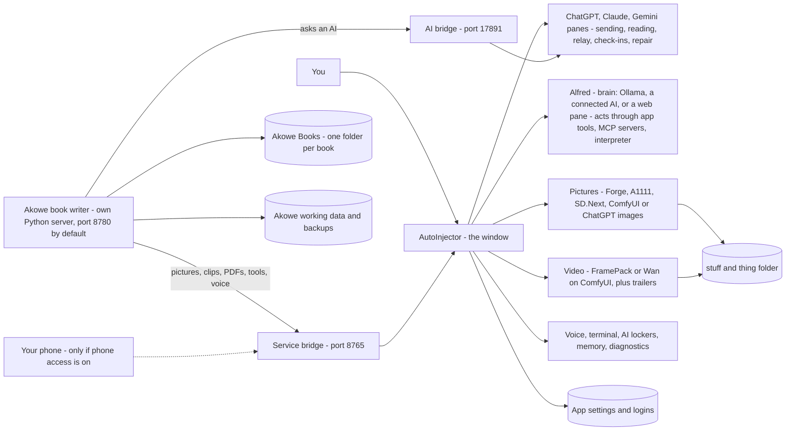

# How AutoInjector works

This page explains how the whole program fits together and what happens behind the buttons. It is not a
button-by-button manual. For that, see the [user guide](USER_GUIDE.md) (also in the app: ❓ Help → 📖 User guide),
[`README.md`](../README.md), [`akowe/README.md`](../akowe/README.md) and [`docs/ALFRED.md`](ALFRED.md). For what changed and when (and how to undo a change), see
[`PROJECT_HISTORY.md`](PROJECT_HISTORY.md).

## 1. The big picture

AutoInjector is one window on your PC. Inside it, ChatGPT, Claude and Gemini each run in their own pane. These are
the real websites, signed in with your own subscriptions, so there are no API bills. AutoInjector types into those
panes and reads the replies, just as you would. Next to them sits **Akọwe**, the book writer. Akọwe is a small
program on your PC, shown in the 📖 Akọwe tab. When Akọwe needs an AI, it asks AutoInjector through a private
connection called **the bridge**. AutoInjector also drives a picture program (Forge, A1111, SD.Next or ComfyUI,
or ChatGPT's own image maker) and **FramePack** or **Wan** for video, on your own graphics card. **🎩 Alfred** is an
assistant that can press the app's buttons for you. He thinks with a local AI (Ollama), an AI you connect with a
key, or one of the web panes. Pictures, videos, models and logs go into **"stuff and thing"**. Books, Akọwe's own
data and the app's settings each have their own place (see section 6).



The same picture in plain text:

```
YOU
 |
 v
AUTOINJECTOR (the window)
 |
 +-- ChatGPT / Claude / Gemini panes
 |     sending, reading, relay between AIs, queues, House Rules,
 |     prompt sequences, attachments, transcripts, check-ins and repair
 |
 +-- 📖 Akọwe tab --> Akọwe's own Python server (port 8780 by default; 8781-8799 if busy)
 |
 +-- 🎩 Alfred
 |     brain: Ollama, OR an AI you connect with a key, OR a web pane
 |     acts through: the app's own tools, MCP tool servers, the code interpreter
 |
 +-- 🎨 Pictures: Forge / A1111 / SD.Next / ComfyUI, OR ChatGPT's image maker
 |
 +-- 🎬 Video: FramePack, OR Wan on ComfyUI  + trailer assembly
 |
 +-- Voice, terminal, AI lockers, memory, diagnostics
 |
 +-- AI bridge (17891)       <--> Akọwe's AI requests and answers
 |
 +-- Service bridge (8765)   <--> pictures, video, trailers, PDFs, tools, voice,
                                  messages, events, and the phone page

AKỌWE (the book writer)
 |
 +-- Idea, characters, world, plot, outline, chapters
 +-- Book Bible, dossiers, continuity and quality checks
 +-- Reviews, rewrites, approvals, reports, backups
 +-- PDF / EPUB / Word exports and the book.akowe file
```

"Port" just means a numbered door on your own PC. The numbers above are the usual ones, not fixed: if a door
is taken, Akọwe tries the next few (8781–8799), and each door can be set to another number. The doors open only to
your own computer (`127.0.0.1`), never to the internet, unless you turn on **phone access**. That opens the service
bridge to your home Wi-Fi, behind its key.

## 2. The parts

### 🤖 AutoInjector (the window)

- **What it is:** the desktop app you start. Folder: `desktop-app/`.
- **Panes:** each AI's real website, side by side. You sign in once; the sites remember you.
- **Typing and reading:** to send a message, AutoInjector types it into the AI's message box and presses Send.
  Every message starts with a number, `[MSG #n]`. A send only counts when that number shows up in the chat.
- **Tags:** each AI is asked to start its reply with `[TO: …]` (who it is for) and end with `[FROM: …]` (who wrote
  it). The closing tag tells AutoInjector the reply is finished. Then it reads the reply. When a site shows the
  `[TO: …]` line in its own little block and the answer in the blocks after it (ChatGPT did in November 2026),
  AutoInjector reads that block and the ones after it, up to `[FROM: …]`, so it gets the whole reply, never just
  "[TO: USER]". It never reads into your own message or the next one.
- **"You forgot your tag" reminders:** a reply with no `[TO: …]` tag is still passed on, and the AI gets one
  reminder. No reminder is typed while Akọwe or Alfred is waiting on that AI, or while its chat is being swapped
  for a fresh one (the reminder would only get in the way of the next request). A reply drawn again a moment later
  with its tags showing is the same reply, not a new one: it is not passed on again.
- **Relay:** a reply marked `[TO: CLAUDE]` is passed on to Claude, and so on. This lets the AIs talk to each other.
  After 30 hand-offs in a row it pauses until you step in.
- **Check-ins and self-repair:** about every 20 minutes, AutoInjector sends each idle AI a tiny test ("Reply with
  only this word: marigold"). They stay out of the app's conversation and are never passed to the other AIs,
  though you may spot them in that AI's own pane. If the AI fails, AutoInjector works out why and tries to fix it:
  other ways to find the box or the reply, a page reload, pressing Stop on a stuck AI. If an AI was busy with
  something, it is then asked to carry on where it left off.
  - **Slow is not broken:** each AI's wait follows how long its check-ins really take (Gemini usually answers in
    about 16 seconds but sometimes takes over 2 minutes), and while a reply is still being written the wait goes on,
    up to 3 minutes. Stop is only pressed when the reply has not changed for a while. An answer that comes in while
    AutoInjector is still checking or repairing (to that check-in or an earlier one) stops the repair; the AI is
    marked 🐢 slow, not broken.
  - If the site answers a check-in with its own error notice ("Sorry, something went wrong…"), AutoInjector
    reloads the window at once instead of waiting.
  - If the page ignores AutoInjector's typed click or Enter (seen on Gemini just after start), the message is sent
    with a real Enter key, then a real click on Send.
- **🎯 Point at it and learned selectors:** websites change their layout. A "selector" is the address of a thing on
  the page, such as "the reply box". When the built-in ones stop working, you can click 🎯 and point at the message
  box, the Send button or the reply. AutoInjector saves that per site. **🔢 Do it for me with a number** teaches it
  by watching you type a number. **↺ Forget what I taught** goes back to the built-in ways. A saved part that
  failed 3 times in a row while the built-in way worked is forgotten by itself, and the log says so once ("ChatGPT's
  saved Send button was out of date and has been forgotten; the built-in one works"). The same happens when a saved
  part was seen not to fit on **3 different starts** of the app (log: `selector-stale-seen`, then `selector-retired`
  with `starts: 3`), because one start often sees too few replies from that AI; a start where the saved part works
  wipes that count. The page then shows one line: "Claude's page changed; AutoInjector stopped using an old saved
  setting that no longer fits." with **↩ Put it back** (the same as **↺ Undo** on the 🎯 card), which brings it
  back. A part you saved in the last hour is never forgotten this way. The "reads only part of each reply" warning
  is only given when there really is a saved reply part; when a site splits a reply over several blocks and there is
  no saved part, reading the whole reply is simply the reader's job.
- **📁 AI lockers (hidden, off by default):** an older feature that gave each AI (ChatGPT, Claude, Gemini) its own
  private folder on this PC (`stuff and thing/ai-lockers/<ai>/`) and let it run file commands there by writing
  `[TO: TERMINAL]`. It was not being used, so it is **switched off and out of sight**, but the code is kept:
  - While off: no 📁 Locker tab in the AI columns (the row is 💬 Last reply · ◀ 🔊 ▶ · ↻, and 💬 Last reply is
    what you see); the AIs are not taught `[TO: TERMINAL]`; if an AI still sends one, nothing runs, the log says so,
    and that AI is told once ("File commands are switched off in AutoInjector") and never again until the next
    start, so it cannot turn into a loop; Alfred does not list or use the locker controls; the 🔬 Feature Test says
    it needs the lockers. No `ai-lockers` folder is made, and an existing one is left alone (never deleted).
  - **To turn them back on:** System AI panel (🎩 Alfred's side) → ⚙ More settings → **⚙ Advanced** → tick
    **AI lockers (advanced, off)**. Everything works as before at once, and the choice is saved. Untick it to hide
    them again. For one run only, starting the app with `AUTOINJECTOR_LOCKERS=1` (or `=0`) overrides the tick.
- **Logs and 📋 Extract:** the app keeps an activity log and a record of every message's journey (the Relay
  Trace). Extract turns these into one file you can share. Keys and private paths are removed.
- **💾 Save state / 📂 Load state** (`save-state.js`, the dialog in `save-state-ui.js`, the wiring in `main.js`):
  a named snapshot of where you are.
  - **What is saved:** each pane's current address (the exact ChatGPT / Claude / Gemini conversation); a backup of
    each pane's newest replies (up to 30, each up to 12,000 characters, from the conversation list the app already
    keeps); the set-up — which AIs are Active, the Compose box, whether 🎩 Alfred is in → All, the open tab, each
    pane's size (open / reduced / minimized), the folded panels, the window size, each pane's zoom; and what you
    were doing — who forwards to whom, Auto, the roles, the hop limit, the 🧵 prompt sequence, and the 📖 Akọwe book
    open in the Akọwe tab (or the one Akọwe last said was open).
  - **Where:** one JSON file per save in AutoInjector's own data folder, `saved-states/` (on Windows
    `%APPDATA%\autoinjector-desktop\saved-states\`). The file name is made from the name (letters, digits and dashes
    only) plus the time; it is written to a temp file and then renamed, so a crash never leaves half a save. The
    file's first line holds the name, time and a short summary, so the 📂 list reads only that. Up to 200 saves are
    kept (the 201st asks you to delete some). A damaged file is listed as damaged and can be deleted; it never stops
    the list. Saves are never sent anywhere.
  - **Loading:** all three panes are sent to their saved chats at the same time. Only `https` addresses on
    chatgpt.com / chat.openai.com (ChatGPT), claude.ai (Claude) and gemini.google.com (Gemini) are opened — anything
    else in a save file (it may have been edited) is refused and that pane stays where it is. After each page loads,
    AutoInjector looks where it really landed: a 404 or a "conversation not found" page means **gone**, a jump to a
    sign-in page means **signed out**, and a jump to another page (the site's new chat) means **moved**. Each is said
    in plain words and the saved replies are shown read-only instead. Then the set-up is put back, and the 🧵 steps
    wait in the Sequence editor (nothing is sent by itself).
  - **Busy:** while a book is written, Akọwe waits for an answer, a picture / video is made, a file is downloading,
    a prompt sequence or a House Rule is running, 📂 Load asks first ("Load it anyway?").
  - **🎩 Alfred** has `saves.list`, `saves.save`, `saves.load`, `saves.rename` and `saves.delete` (app actions in
    `alfred-app-actions.js`); loading shows his "I will…" card, and when something is busy he is told so and only
    loads anyway after you say so.
  - The log gets codes and counts only (`savestate-save`, `savestate-load` with each pane's result word) — never a
    name, an address or chat text.

### 🔗 The bridge (how Akọwe asks an AI)

- **What it is:** a small private door inside AutoInjector. Code: `desktop-app/akowe-bridge.js`. Details:
  [`AKOWE_AUTOINJECTOR_BRIDGE.md`](AKOWE_AUTOINJECTOR_BRIDGE.md).
- **Connection key:** like a password, so only your Akọwe can use it. AutoInjector pairs the two by itself.
- **One request, step by step:**
  1. Akọwe sends a request: which AI, the full prompt, and an ID.
  2. AutoInjector types the prompt into that AI's pane, with its `[MSG #n]` number.
  3. It waits for the reply that answers that exact number.
  4. It removes the tags and hands the text back to Akọwe. That reply is never relayed to the other AIs.
  5. Akọwe checks the answer. Most answers must be a tidy block of data (JSON). If not, it asks again, up to two
     more times. When AutoInjector says the chat can be continued, the second ask is only a short correction ("your
     last answer was not valid JSON: …"), not the whole prompt again. AutoInjector types it into the **same chat**,
     and only when nothing changed there since the answer (no fresh chat, nothing else typed, you did not type in
     that pane); otherwise it types nothing and Akọwe sends the whole prompt at once. If the answer is still broken, or the AI
     refused, the work goes to another AI that works before anything stops.
- **When it can't answer:**
  - **Busy:** one request per AI at a time. A second one hears "busy", and Akọwe waits and retries.
  - **Site error:** the site showed its own notice ("Something went wrong", a usage limit) or a short canned
    refusal ("I'm having a hard time fulfilling your request. Can I help you with something else instead?"). Akọwe
    waits (30 s, or 60 s after a usage limit, then longer, up to 2 minutes each and about 10 minutes in all) or uses
    another AI. When the refused prompt was very long (30,000 characters or more), the note says so.
  - **The AI declined:** a short canned refusal ("I can't help with that") has its own code, **AI_DECLINED**
    (AutoInjector's bridge marks it `declined`). It is never reported as "the site is not working": the reports say
    "Gemini declined to answer (it said it can't help with that)". The work still moves to another AI, or waits and
    asks again. Sad or dark story material (a death, grief, a ghost) sometimes trips an AI's safety filter by mistake.
  - **Chat full:** the site says the conversation is too long ("…exceed the length limit for this chat", "start a
    new chat"). Akọwe hears "site error: chat full" and asks again after 10 seconds; AutoInjector opens a fresh chat
    in that pane first (see **Fresh chats** below).
  - **Every AI at its usage limit:** Akọwe waits for a limit to reset, by itself: "All AIs hit their usage limits
    — waiting; resumes by itself at about 3:40 PM" shows in the run window and the activity strip. It checks every
    few minutes (or at the reset time the site showed: AutoInjector reads "until 3:40 PM", "resets 3pm" or "try
    again in 2 hours" from the site's limit notice and passes it on) for up to 6 hours (Settings › ⏳ When the AI is busy), then
    goes on. Only after that whole time does the run pause.
  - **Not working:** an AI that is being repaired, logged out or broken is skipped. Its work goes to another AI.
  - **Timeout:** no answer in time (every AI call has its own time: at least 5 minutes for a web AI, also for each
    scene of a long chapter). When the prompt was typed, Akọwe first collects the late answer (it asks again with
    the same request number, so nothing is typed twice). If none comes, the work goes to another AI that works, or,
    with only one AI, that AI is asked once more after a minute. Only then does the step pause for 🔁 Try again. A
    late answer is never used twice.
- **"Akọwe is using this AI":** while Akọwe waits for an AI's answer, that AI's card in the 🤖 AutoInjector tab
  shows a yellow note: "📖 Akọwe is using Claude right now… Please don't type in Claude's window until it is done —
  use another AI meanwhile." It goes when the answer is in. (Typing your own question there would land between
  Akọwe's prompt and its answer.)
- **Fresh chats:** a book run sends about 1,000 messages. Kept in one chat, the chat gets slow and the site stops
  it ("this chat is too long"). So AutoInjector opens a **new chat** in an AI's pane for Akọwe after **15 Akọwe
  requests** or about **300,000 characters** in that chat (change it in the 📖 Akọwe panel: 🆕 Fresh chat for
  Akọwe), and at once when the site says the chat is full. It presses the site's own **New chat** button, or opens
  the site's new-chat page if that button can't be found. It only happens **between** Akọwe requests (never while
  an AI is writing), and never in a pane **you** used yourself in the last 10 minutes (unless the site says the chat
  is full). The activity log says each time, in plain words. Code: `desktop-app/fresh-chat.js`. While the pane
  switches to the new chat, AutoInjector reads nothing from it: a half-swapped page is never taken for a new reply.
  When the New chat button does not give an empty chat, the page is reloaded at the new-chat address; the log's
  `reload` line then says `by: "fresh-chat"` (not "self-repair").
- **A fresh chat for every new book:** each Akọwe request says which book (`book_id`) and which ⚡ run (`run_id`)
  it is for — ids only. When an AI pane's last Akọwe request was for a **different book** (a new ⚡ Make-a-book run,
  a sequel, or you switch books), AutoInjector opens a new chat in that pane **before** typing the first request
  of the new book. Otherwise the AI could take names or story details from the other book still in that chat (a
  real run used a character from the author's other book as the "invented" pen name). The **same book** keeps its
  chat: ⏸ Pause → ▶ Resume, ▶ Continue making this book, or a restart of the app (the last book of each pane is
  saved, ids only). The same safety rules apply: only between requests, never while the AI writes, never in a pane
  you used in the last 10 minutes (it waits for a later request instead). The log line is `akowe-fresh-chat` with
  `reason: "new-book"`. Switch: 📖 Akọwe panel → 🆕 Fresh chat for Akọwe → **and for every new book** (on by
  default). Costs no AI answers. Code: `fresh-chat.js` (`noteBook`), `akowe-bridge.js`, Akọwe `providers.py`
  (`bridge_book_fields`).
- **💡 Strongest model tip:** a one-line tip by Start on the Make-a-book screen and above the AI cards in the 📖
  Akọwe panel: pick the strongest model in each AI window before you start. ✕ hides it for good (remembered in that
  browser / on that PC).
- A second door, the **service bridge** (port 8765), does more than the AI bridge. Akọwe uses it for pictures,
  video clips, trailers, the ebook cover JPG and the Book Bible PDF. It also carries the app's tools, voice (speak
  and listen), messages to the AIs, live events, and the phone page.

### 📖 Akọwe (the book writer)

- **What it is:** a Python program that runs on your PC. AutoInjector starts it and shows it in the 📖 tab.
  Folder: `akowe/`. Its working data lives in `%LOCALAPPDATA%\Akowe` on Windows.
- **Records:** every piece of the book is a **record**: a character, a place, the premise, the outline, a chapter.
- **Versions:** a record is never changed in place. Each change makes a new **version**. Old versions stay.
- **Approvals:** a new version starts as a **draft**. It becomes part of the book only when it is **approved**.
- **Canon:** the approved records together are the book's **canon**, the official truth everything else must match.
- **Out of date (stale):** if something a record was built from changes, Akọwe marks that record out of date.
- **AI slots:** AI-1, AI-2 and AI-3. By default they are Claude, ChatGPT and Gemini, through the bridge.
- **⚡ AI activity:** while any AI works for Akọwe, a slim strip under the top bar shows, on every page, one row per
  AI: which AI, what it is doing in plain words ("Writing chapter 7", "Reviewing chapter 7", "Second review of chapter 7",
  "Checking chapter 7 for consistency (all AIs)", "Chapters 6–10 review", "Check consistency now: chapters 3–7",
  "Writers' room: pitching a twist"), for which book, where it is (waiting for the AI, answering, checking the answer, or waiting after a busy
  site with the seconds left), how long so far, and in a ⚡ run "chapter 7 of 20" with a small bar. When it finishes
  the row says ✔ Done (or ✖ / ⏳ / ⚠) for a few seconds and goes; with nothing at work the strip is gone. Click a row
  to open the run or the book. Code: `akowe/akowe/ai_activity.py` (every AI call passes one place that reports to it).
- **✍ Write alongside me:** on a chapter's page, highlight a passage (or put the cursor) and press ✍ Continue from
  here, 🔁 Rewrite (with an optional note, such as "more tense"), 🎨 Describe more, ➕ Expand or ✂ Tighten. The AI
  (by default the one that wrote the chapter) gets the text around the passage, the chapter's plan and needs list, the
  voices of the characters there, the locked details, the running notes, the story rules, the point of view and tense,
  and your content limits. You see its suggestion next to your text, with ⚠️ notes when it slips into another person
  or tense or changes a locked detail. Nothing changes until you press ✔ Use this: that saves a new version for you
  to approve, exactly like your own edit.
- **🗳 Writers' room:** for a big decision (a plot twist, how a chapter ends, a character's secret, or your own
  question), each working AI pitches one idea. The pitches are shuffled and labelled A, B, C, and each AI ranks the
  others' pitches (never its own) with a reason. Most first places wins; a tie goes to the sum of ranks, then to you.
  Using a pitch saves it as a new draft marked "From the writers' room"; the approved text stays until you approve
  it. With only one working AI, you can ask it for three ideas instead. (This is not the desktop app's Council, where
  the panes chat with each other.)
- **📣 Mockups & ads:** made from your 🎨 cover: your book as a 3D paperback, hardcover, stack or series, and on a
  phone, tablet or e-reader; ads at the exact sizes Instagram, Facebook, X and Amazon ask for (with your hook and
  "Available now", words kept clear of the apps' buttons); and 13-second teaser clips, tall and square. AutoInjector
  draws the pictures and joins the clips. When the cover or the hook changes, the old files are marked out of date.

### 🤖 Claude Code helpers (optional, makes books faster)

- **What it is:** Claude Code is Anthropic's command-line tool. When it is on your PC and signed in, Akọwe runs small
  side jobs through it, several at a time ("helpers", 3 by default, 1–5), while the three web AIs do the main writing.
  Code: `akowe/akowe/claude_code.py` (finding it, the signed-in check, running one job safely),
  `claude_code_jobs.py` (the jobs) and `claude_code_book.py` (where they join a ⚡ run).
- **What the helpers do in a ⚡ run:**
  - **Research ahead:** while chapter 5 is written, they research what chapters 6–8 will need (history, places,
    trades, folklore) with real web sources. Each note is labelled **established fact**, **disputed**, **legend** or
    **invented for the story**, with its source; a note that claims to be real but has no source is thrown away. The
    notes are handed to those chapters' writers.
  - **Fact check with sources:** every written chapter's real-world claims are checked on the web. Wrong ones get a
    small fix. You see them on the chapter page (🤖 Claude Code helpers box) and under 🔎 Fact checks.
  - **Checks side by side:** the all-AI check of each chapter is split by kind — continuity (against the Book Bible
    and the running notes), the characters' voices, and facts — and the helpers do these at the same time, while
    ChatGPT and Gemini read one after another. What they find goes into the same check, with the same "two AIs agree"
    rules, the same fixes and the same reports.
  - **"Sounds like AI" pass:** after a chapter is approved, they look only for the lines that sound machine-written
    (stock phrases, "Not X. Not Y.", lists of three, too many dashes, tidy moral endings, feelings explained after
    they were shown, every chapter opening or ending the same way, a gesture used too often) and propose a rewrite of
    just those lines. Nothing changes until you tick them and press ✔ Use — that saves a new draft for you to approve.
    Lines with a locked detail, a name or a number they would change are never proposed.
- **Step 2 — faster, better, less machine-written** (code `claude_code_speed.py`):
  - **The next chapter is ready early:** as soon as a chapter is approved and its running notes are updated, a
    helper plans the next chapter's scenes and its needs list while this one is checked. When the next chapter
    starts, Akọwe reads the facts again: if nothing changed, the chapter starts at once with that plan (another AI —
    never Claude — still checks the scenes); if the check or the notes changed something, the early plan is thrown
    away and the chapter is planned again. A chapter is never written from out-of-date facts.
  - **The Book Bible is filled side by side:** with "Fill the whole Book Bible" on, its batches go to several helpers
    at once (relationships after the characters); every answer is checked and approved the same way; a batch a
    helper cannot do is asked of a web AI.
  - **Extras in the background:** the character pictures (🎨 Images, Stable Diffusion) are made while the book is
    written, and the 🚀 launch kit gets first drafts (blurb, description, hook, keywords…) as soon as the chapter
    outline is approved — drafts for you to approve. The book does not wait for them.
  - **Specialist reviewers** in each chapter's all-AI check: each main character's dialogue against their voice card
    (only when they speak), pacing (off unless you tick it), senses and concrete detail (only chapters with few) and
    subtext (only chapters that name feelings). What they find joins the same check and the same fixes.
  - **Variety:** the next chapter's writer sees how every chapter so far opened and ended, with a helper's advice
    for the planned opening and ending.
  - **Your style, specific details, real dialogue:** with a ✒️ style card, lines that drift from your style; and
    generic details ("a nice house") and too-tidy dialogue — each with a proposed rewrite on the chapter page.
    Nothing changes until you tick them and press ✔ Use. Names, numbers, locked details and story-map passages are
    never touched.
- **The writer never checks itself:** Claude Code counts as Claude. When Claude wrote a chapter, the helpers only
  check its facts and propose "sounds like AI" fixes; the independent reviews stay with ChatGPT and Gemini. When
  ChatGPT or Gemini wrote it, the helpers read it for Claude, so the Claude pane is free.
- **It shares your Claude plan's limits:** Claude Code signs in with your own Claude account, so its use counts
  against the same limits as the Claude pane and claude.ai. Fewer helpers at once = slower but gentler on the limits.
- **How to install and sign in:** ⚙️ Settings → 🤖 Claude Code helpers has two buttons (`claude_code_window.py`).
  **⬇ Install Claude Code** opens a PowerShell window running Anthropic's official installer
  (`irm https://claude.ai/install.ps1 | iex`, as on https://code.claude.com/docs/en/setup). **⌨ Open Claude Code**
  opens a command window (`cmd /k`) with the Claude Code Akọwe found already started, in your home folder and without
  any API-billing key, so it signs in to your Claude plan; follow its steps once. Only fixed commands are run, and
  only for a request from this computer (a phone on the network is refused). Afterwards the card shows
  "✔ Claude Code 2.x found, signed in" (press ↻ Check again). On a Mac it opens Terminal; on Linux the first terminal
  found.
- **Without it nothing breaks:** if Claude Code is not installed, signed out, at its limit or not working, every job
  goes back to the web AIs, exactly as before. The book never waits for a helper. The run window says so in one line.
- **Settings:** ⚙️ Settings → 🤖 Claude Code helpers: on/off (on by itself when it is found), helpers at once (1–5),
  which jobs are on (eleven, all on by default) and which specialist reviewers run (dialogue, senses and subtext on;
  pacing off). The ⚡ Make-a-book screen has a "Use Claude Code helpers for this book" tick.
- **Speed is measured:** the run window and ⏱ Time and AI use show "the checks took 1.2 min side by side instead of
  about 3.4 min one after another", and for Step 2 "next chapter ready early: 9 chapter(s) started without waiting
  for their scene plan", "Book Bible filled side by side in 2.1 min instead of about 8.0 min" and "extras in the
  background: about 6 min … off the run".
- **Safety and privacy:** each job runs in its own empty temporary folder with no file-editing or command tools (only
  web search and web pages for research and fact checks, nothing for the checks). Your chapters go to Claude Code
  through its input, never on the command line. Akọwe's log keeps only codes, counts and times — never your text.

### 🎨 Images

- **What it is:** the 🎨 Images tab. It drives a picture program on your PC: Forge, A1111, SD.Next or ComfyUI.
  AutoInjector can find, start or install one.
- **Engines:** Stable Diffusion (Forge, A1111, SD.Next or ComfyUI), ChatGPT (it draws inside its own pane), or
  Auto.
- **Checkpoint models and LoRAs:** a checkpoint model is the main picture model. A LoRA is a small add-on that
  teaches it one look or style.
- **Good pictures by default:** AutoInjector sees which kind of model the checkpoint is (SDXL, SD1.5, Pony, Flux)
  and uses that model's own picture sizes (Portrait / Square / Landscape), its best sampler, steps and CFG, and a
  sensible "what to avoid" list. **Style** chips (Photo-real, Cinematic, Illustration, Anime, Painting) make
  "realistic" one click. A very long description (Akọwe's portraits) is shortened for the model, looks first; the
  full text stays in the picture's `.json`. **📖 Book pictures use** picks the checkpoint for Akọwe's pictures.
- **🧩 LoRAs:** a small LoRA browser in the form: search, filters (fits this model, recent, ★), cards with a
  preview, the base model and trigger words. Each chosen LoRA gets a weight slider, 🔑 (add its trigger words)
  and ✕, and a red warning if it was made for another kind of model.
- **🔒 Character locks:** a saved recipe (a LoRA, trigger words, fixed looks, or a portrait) that keeps one
  character's face the same in every picture. In a ⚡ run, each character's portrait becomes its lock.
- If you turn on something the picture program doesn't have (ADetailer or ControlNet on a Forge without that
  extension), the picture is still made without it, and a ⚠ line says what was left out and how to add it, with a **🧩 Install it** button.
- **🧩 Add-ons:** shows the add-ons (extensions) in Forge, A1111 or SD.Next, or the custom nodes in ComfyUI. It
  lists useful ones (ADetailer, Regional Prompter, Dynamic Prompts, Ultimate SD Upscale and more) with Install,
  Update and Remove, and can install from a GitHub link after asking. It only copies the add-on's files into the
  app's folder. Then it offers **🔁 Restart Forge now** (if AutoInjector started Forge), or says to restart it in
  Stability Matrix. Remove moves the add-on to a `_removed` folder. If it can't find Forge's folder, you pick it
  once. **Open Forge's own Extensions page** shows Forge's own screen in a window.
- Pictures are saved in `stuff and thing/images/`, each with a `.json` file of the settings that made it.
- **Tested for real:** pictures have been made with Forge on your PC.

#### What is saved with each picture

Every picture keeps a full note of how it was made, in its `.json` file and inside the PNG itself (the "parameters"
text that Forge, A1111 and Civitai can read). Open **Settings used** under a picture to see it in plain words:

- what you typed, what was actually sent (shortened, with the style words) and the full description;
- the "things to avoid" list, and whether it was the automatic one;
- the style chip, the checkpoint model with its hash and kind (SDXL, SD1.5, Flux …), the VAE;
- the sampler and scheduler, steps, CFG, size, and the **real seed** (the number that makes this exact picture, never -1),
  and which picture of a batch it was;
- hires fix, refiner, every LoRA with its weight (and hash when known) and the trigger words added;
- ADetailer and ControlNet, the start picture and how much it changed (img2img / inpaint), CLIP skip;
- which program made it (Forge, A1111, ComfyUI and its workflow, or ChatGPT — ChatGPT has no seed or sampler, so those
  are left out), the AutoInjector version;
- who asked: you, 🎩 Alfred, or Akọwe (with the book and the character), and the recipe if one was used;
- the AI judge's verdict, once a picture is judged.

**♻ Remake** puts those settings back into the form; press 🎨 Generate and the same seed makes the same picture.

#### 💾 Recipes (saved settings)

A **recipe** is a set of saved settings with a name, for example "Realistic portrait — SDXL": the model, size,
sampler, steps, CFG, style, "things to avoid", LoRAs and their weights, hires fix and ADetailer. It never holds the
words of one picture; it can hold a **prompt template** such as `{subject}, soft window light`, where `{subject}` is
replaced by what you type.

- The **Recipe** list at the top of the form loads one. **💾** saves the form as a recipe, **✏** renames, **🗑** deletes,
  **⭐** makes it the default (it is loaded when the Images tab opens).
- **💾 Save as recipe** under any picture saves the settings that picture was made with ("use these settings again").
- A few **starter** recipes come with the app, made from the usual settings for each kind of model: Realistic portrait
  (SDXL), Cinematic scene (SDXL), Portrait with hires fix (SD1.5), Book character portrait (SDXL), and Natural
  picture (Flux, shown only when a Flux model is installed). They are a good beginning, not magic: you can copy them
  and change them.
- **📖 Book pictures use** can be a checkpoint or a recipe, so Akọwe's pictures get all of that recipe's settings.
- Alfred can list, load, save, rename and delete recipes, and change any field of the Images form. He always shows
  his "I will…" card first.
- Recipes are kept in AutoInjector's own data folder (`sd-recipes.json`, next to `sd-library.json`).

#### 🧑‍⚖️ The AI judge and 🔁 Make it better

- **🧑‍⚖️ Judge** (under a picture) sends the picture and its settings to an AI that looks at it. It gives scores from 1
  to 10 (does it match the words, how good it looks, hands and faces, mistakes such as blur, extra fingers, text or
  melted details, composition and light, and how well it looks like the character when there is a character lock),
  a verdict (**keep**, **fix** or **redo**), what is good, what is bad, and what to change. The verdict is saved with
  the picture. If the judge's verdict doesn't match its own scores, AutoInjector goes by the scores and says so.
- **🔁 Make it better** judges the picture, changes the settings and words the judge suggested (more steps, a different
  sampler, the model's own size, hires fix, ADetailer for the face or hands, words to avoid, a LoRA weight, another
  installed model, a new seed …), makes it again and judges again — up to 3 rounds (you can choose 1 to 5). It stops
  early when a picture passes, or when it stops getting better. Every round is kept and shown side by side with its
  score and what changed. **✔ Keep this one** shows the one you like; **💾 Save these settings as a recipe** keeps its
  settings. Your own defaults are never changed. **⏹ Stop** stops it.
- **Make 4, pick the best** (next to 🎨 Generate) makes 4 pictures with different seeds, judges each, and shows the best.
- **Which AI judges** (🧑‍⚖️ AI judge settings, in the form): the first one that is ready, in this order unless you change it:
  1. **Claude Code** on your PC (it uses your Claude plan). AutoInjector puts the picture alone in an empty folder and
     lets Claude Code use only its Read tool to look at it.
  2. **A web AI pane** (Claude or ChatGPT): a new chat, with the picture uploaded. It never interrupts a pane Akọwe is
     using for a book; it says so instead.
  3. **A local vision model** in Ollama (for example qwen2.5vl or llava): offline and free, but weaker — its verdicts
     are marked "weaker".
  The result always says which judge was used. Each judge can be switched off.
- **It uses AI usage.** Each judgement is one AI answer (your Claude plan or ChatGPT), except the local model. Make it
  better uses one per round, Make 4 uses four. The buttons' tooltips say so.
- **Judge and improve book pictures automatically** (off by default, because it costs AI usage): Akọwe's character
  pictures are judged and improved (at most 2 rounds) before Akọwe gets them.
- Alfred can judge a picture, run Make it better and Make 4 for you, and explains the verdict in plain words.
- The log keeps only codes and scores, never your prompts.

### 🎬 Video

- **What it is:** the 🎬 Video tab. Two engines:
  - **FramePack**, the copy you already have (for example in Stability Matrix). Nothing is downloaded.
  - **Wan** on ComfyUI. Its models download inside the app.
- **Trailers:** shots and title cards joined into one trailer (WebM, plus MP4 when ffmpeg is found). Akọwe's
  🎬 Trailer page plans the shots from the book.
- **Everything is saved with every video** (`video-record.js`): next to each clip is a `.json` file with what you typed
  and what was sent, the negative prompt, the engine (Wan 2.2 5B / Wan 2.1 1.3B / FramePack) and its model files, the
  ComfyUI graph, the length, fps, frame count and size, steps, CFG, shift / sampler / scheduler (FramePack: distilled
  CFG, TeaCache, GPU memory kept free), the **real seed**, the starting picture (and a link to its own `.json`), who
  asked (you / Alfred / Akọwe's trailer + book), the recipe, the AI judge's verdicts, how long it took and the app
  version. **Settings used** under the player shows it in plain words. **♻ Remake** makes the same video again,
  exactly (same prompt as sent, same seed, same settings, same starting picture); **✎ To form** puts the settings back
  into the form so you can change one thing.
- **💾 Recipes** (`video-recipes.js`, `video-recipes.json`): the picker at the top of the form, with 💾 ✏ 🗑 ⭐, the
  same as 🎨 Images. They are a separate list from the picture recipes (a video recipe has nothing a picture can use
  and the other way round), kept by the same store. Five starters come from the engines' own defaults: text → video and
  picture → video with Wan 2.2 5B, "Quick and light" with Wan 2.1 1.3B (about 8 GB), picture → video and "Character
  moves" with FramePack. A trailer can use a recipe for all its shots.
- **🧑‍⚖️ Judge** (`video-frames.js`, `video-judge.js`, `video-improve.js`): AIs can't watch a video, so the judge gets a
  **contact sheet**: about 8 frames taken evenly across the clip, side by side in time order, each labelled with its
  frame number and time (for picture → video the starting picture is the first tile, labelled START). The frames come
  from ffmpeg when it is on the PC (found the way the trailer finds it), otherwise from the app's own player (a hidden
  window plays the clip and copies each frame). A **frame check that needs no AI** compares up to 32 frames and flags a
  frozen video, sudden jumps and flicker. The judges are the same ones, in the same order, as for pictures (Claude Code
  on your PC, then a web pane, then a local model) and each judgement uses **one AI answer**. Scores 1–10: matches the
  prompt, picture quality, stays the same across frames, natural motion (no melting), no flicker (the AI's view and the
  frame check together), and for picture → video, faithful to the starting picture. Suggested changes come from a fixed
  list (steps, CFG, seconds, fps, the model's own sizes, shift / calmer motion, distilled CFG and TeaCache for FramePack,
  a new seed, words to avoid, prompt words, another engine, "use a better starting picture" → 🎨 Images).
- **🔁 Make it better:** the judge looks at your video, its changes are tried in a **quick preview** (about 1.5 s, the
  model's smaller size of the same shape, the same seed), the preview is judged, and so on — up to 3 rounds (5 at most).
  It stops early when one passes or when two in a row are no better. The strip shows every round (point at one to play
  it) with its score and what changed. Then it asks before the **one full-length, full-size video** with the best
  settings and says how long it will take (measured from your earlier videos when it can). ⏹ Stop works at any point,
  also in the middle of a render. ✔ Keep this one / 💾 Save these settings as a recipe. Your defaults are never
  changed. **Make 2, pick the best** (2–4) makes several videos with different seeds and marks the best one.
- **Trailers:** "🧑‍⚖️ Judge and improve trailer shots automatically" (off by default — it costs AI answers and time):
  each new shot is judged and improved (at most 2 quick previews, then the full shot) before joining.
- **Alfred** can do all of it (`video_call`: `video.record`, `video.remake`, `video.judge`, `video.improve` →
  `video.improveFinal`, `video.makeBest`, `video.recipes.*`, `video.judgeSettings` …), always through his "I will" card.
- **Not yet confirmed on your PC:** on your RTX 5070 Ti, four test rounds fixed start-up and loading problems.
  A first finished clip, picture → video, text → video and a trailer still need to be confirmed. Use
  🩺 Test pictures & video (Full).

### 🎩 Alfred

- **What it is:** an assistant in a side panel (Ctrl+Shift+A). He is off until you turn him on.
- **His AI (his "brain"), three choices:** a local model through Ollama (the default; nothing leaves your PC),
  an AI you connect with a key (any OpenAI-compatible service), or one of the ChatGPT / Claude / Gemini panes.
- **Tools:** a fixed list of the app's own controls: books, pictures, video, the panes, files and logs. He cannot
  run any code you have not allowed.
- **The big buttons don't depend on his AI:** 🎨 Make a picture, 🎬 Make a video, 🖼 Design a cover, 🧑 Make a
  character and ✍ a new book turn what you typed into the action itself and show the "I will" card at once (his AI is
  not asked, so a small local model can't answer them with words only). 📖 My book / ✍ Continue ask his AI, and read
  the book's status directly when it answers without looking or doesn't answer. "Draw me a lighthouse" typed to him
  and answered in words gets one retry, then a one-click **🎨 Make it now** card. The activity log says how every
  request ended (`alfred-reply`, `alfred-no-action`), without the words.
- **Asking the other AIs for him (PR #126):** `ask_ai` types a message into ChatGPT, Claude or Gemini (after an "I will"
  card) and **waits for that AI's answer** (up to 3 minutes; the same proven-send + capture path as an Akọwe request),
  so "get a prompt from ChatGPT for a dragon picture and make it more dramatic" finishes in one go: the answer comes
  back, his AI rewrites it, he shows it. If his AI only answers in words, he retries once, then offers **💬 Ask ChatGPT
  now**; if his AI can't rewrite, he shows the answer and says so. An AI an Akọwe request is waiting on is refused.
  He always answers — an empty or unusable reply from his AI becomes a plain "I couldn't do that, because …". After two
  struggles in a row with a local model, his panel offers **Use Claude (web pane) as Alfred's brain** / **Use a bigger
  model** (only a click changes it).
- **🔓 Uncensored finder and 🧪 writing test (PR #127):** in 🔎 Find a model, **🔓 Uncensored** lists only uncensored
  models from the Ollama library and Hugging Face, each rated for this PC (★★★ / ★★ / ★ / 🐢 / ✖, with the Hugging Face
  size that fits the graphics card), with its speed, a "refusals removed — same skill as the base model" line and a
  🛠 / ⚠ tool hint; offline it shows the last list it found, or a built-in one. **🧪 What will it write?** asks a
  downloaded model for six short fiction passages on the PC (battle, villain, swearing, grief, romance, a heist) and
  scores each ✅ wrote / ⚠ softened / ✖ refused, with a verdict. Only the scores are logged.
- **"I will…" cards:** before he changes anything, he shows a card saying what he will do. Nothing happens until
  you press ✔ Do it, unless you ticked "always allow" for a harmless tool. Running code and outside tool servers
  never get "always allow". He never approves your chapter drafts. He can approve a Character Forge proposal,
  but only through an "I will" card.
- **Tool servers (MCP):** you can add outside tools (files, a database, a web service). He uses them only through
  an "I will" card, every time.

### 🎤 Talking to the AIs and 🔊 hearing their replies

- **🎤 at the top (title bar):** click it and speak; it turns red and counts the seconds. Click again and **your words
  appear in the Compose box first, so you can fix a misheard name** — then press **→ Send** on the line at the top (or
  ✕ Clear). Sending goes the same way the Compose box sends, so House Rules and relaying work the same. If you would
  rather skip the check, tick **"🎤 Send what I say right away"** in System AI → 🔊 Voice.
  The box beside it says who hears it: **All** (every AI ticked as Active, plus 🎩 Alfred when his box is ticked, just
  like → All), or one AI, or 🎩 Alfred (only while he is on). It remembers your choice. **Esc** stops without sending.
- **🎤 in each AI's header** sends to that AI only.
- **What was heard** shows in one short line at the top: "🎤 Heard: “…” → sent to Claude". While it is still working
  out the words you can press ✕ Cancel. If nothing was said, nothing is sent.
- **◀ 🔊 ▶ "3 / 7" on each AI** (beside 💬 Last reply): ◀ and ▶ step through that AI's replies (it starts on the
  newest and follows new replies while you are on the newest); the number says which one you are on, and the tooltip
  shows its first words. 🔊 reads it aloud; ⏹ stops at once. Code is read as "(code block)" and links as "a link to
  example.com". Only one thing speaks at a time. Alfred's messages in his panel have a 🔊 too.
- **What it needs:**
  - *Speaking to the AIs* needs the free **voice engine** (Setup Wizard → 📦 Installs → "Voice engine"). It works
    offline. The app starts it by itself when you press 🎤. The first time, it downloads the speech model (about
    150 MB; a bigger, better one on a graphics card). It uses the graphics card when it can, else the processor.
  - *Hearing the replies* needs nothing: it uses the voices built into Windows. For nicer voices install a
    **piper voice** (Setup Wizard → 📦 Installs → "Voice model"; more `.onnx` voices can go in
    `stuff and thing/models/voice`).
- **A voice for each speaker:** ChatGPT, Claude, Gemini and Alfred each get a different voice (and a slightly
  different pitch and pace). Change them in the System AI panel → 🔊 Voice → "Read-aloud voices", with the speed and
  a ▶︎ test.
- **Privacy:** what you say and what is read stay on your PC. The log notes only that something was heard or read
  (and how long it was), never the words.

### 🩺 The self-tests

| Test | Where | What it proves |
|---|---|---|
| 🩺 Check everything | Alfred | his AI, disk, Stable Diffusion, Akọwe, the panes, the logs; with Fix buttons |
| 🩺 Test pictures & video | 🎬 Video or 🎨 Images | Quick: everything is reachable. Full: one picture, one clip, a tiny trailer |
| 🧪 Test the connection | Akọwe panel | the bridge, the key, and a real question to each AI |
| 🩺 Check now | AI cards | a check-in for each AI |
| Run relay check | Tools menu | the AIs pass a list round; shows where messages get lost |
| 🧪 Test workflow, Test everything | Akọwe (Advanced view) | Akọwe's own steps, end to end |

## 3. What happens when you press ⚡ Make a book

Pressing Start is your **consent for this run only**. The run makes a brand-new book; your other books are never
touched. It works by itself, so you can leave the PC: AutoInjector keeps the PC from going to sleep while the book
is being written, and tells you (a Windows notification) if the run needs you (see **"Leaving a long run on its
own"** below). If you close the AutoInjector window while it works, it asks first; choose **Keep running in the
background** to carry on. First, AutoInjector checks in with every AI (up
to a minute), so the run knows which AIs work.

1. **Safety backup** of all your books.
2. **Invent the book:** title, genre, readers, tone and the idea. The AI **never** chooses the pen name (code:
   `akowe/akowe/pen_name.py`): the book gets the pen name you typed on the Make-a-book screen, else the last pen name
   you typed into a book profile (your saved pen name), else none. Why: the AI used to be asked for "an invented pen
   name", and a web AI whose chat still held your other book answered with that book's main character, which went
   onto the title page. The plan check before Start shows which pen name the book gets and warns (⚠️) when it is also
   the name of a character in another book on your shelf; the run and the book profile warn the same way. The point of view (first or third
   person) and the tense (past or present) are fixed here too, from your choice, else the AI's pick for this
   story, else the genre's usual. If you left the **kind of story** to the AI, it picks the one of the seven basic
   plots that fits the idea best here, and the run's notes and the plan page say which and why.
3. **Characters and places:** drafted, reviewed, approved. The main character (★) is guaranteed to exist.
4. **Character sheets and voices:** what each character wants, needs, fears and hides, and a **voice card** for
   how each one talks.
5. **Looks and voice details:** only the essentials (height, face, hair, clothes…). Everything else waits.
6. **Character pictures:** a portrait each, made with Stable Diffusion; each becomes that character's 🔒 lock.
   This never holds up the book.
7. **Story rules and world texture:** what is law in this world, what is only believed, and real-world obstacles.
8. **Premise**, then **main plot**, then **chapter outline**. If you picked a **story shape** (Three acts, Save the
   Cat, Hero's Journey or Seven-point), the outline is planned on it and each of its beats is placed on a chapter
   (shown as "Ch 22 · Dark night of the soul" on the plan page and in the Book Bible); a beat the AI leaves out or
   misplaces goes where it usually falls in a book.
   If you picked a **kind of story** (the seven basic plots: Overcoming the Monster, Rags to Riches, The Quest,
   Voyage and Return, Comedy, Tragedy, Rebirth) — or left it to the AI, which then picks one in step 2 and says
   which — the premise, main plot and outline are planned through its stages, and each stage gets the chapters it
   covers (shown as "Ch 9–11 · The nightmare" with the kind's promise, such as "the hero defeats the monster").
   - **Optional: the writers' room for the big twists** (off unless you turn it on at the start). Before the main
     plot, and before the middle chapter and the climax, each working AI pitches an idea and they vote blind. The
     winner is used under your run consent and written in the journal. It never holds up the book.
   - **Optional: fill the whole Book Bible** from the plan before chapter one. It is off unless you turn it on
     (on the start screen, or 📖 Book Bible → At a glance). It never holds up the book.
9. **Every chapter.** For each one:
   - **Just-in-time details:** if the chapter has a fight, the fighters' style and weapon are decided now. A new
     place gets its rooms, sounds and smells. Once a chapter uses a detail, it is **locked**.
   - **Scene cards:** the writer plans the scenes. A different AI checks them. With the scene cards the planner
     also writes the chapter's **needs list** 🧠: exactly which Book Bible sections it needs, by code
     (`Chapter 7 needs: Mara C11, C44 · Brass key I22 · Notes N11(Mara) · Earlier: chapter 3 (…)`). Akọwe checks the
     codes, and gives the writer just those sections, a short quote of each earlier moment, and only the running
     notes asked for — nothing missing, nothing extra. An empty section on the list is filled just in time first.
     Older plans without a list keep the old way (Akọwe guesses from the plan's words).
   - **Writing:** the writer gets the plan, the voice cards, the locked details, the end of the last chapter, the
     story so far, and your promises to the reader: content limits, themes, the central question, the point of
     view and tense. If the instructions are too long, the least important parts are cut first, and the run shows
     ⚠️ with exactly what was cut.
   - **✍ Two first pages (chapter 1 only)** (code: `akowe/akowe/first_page.py`; run setting `first_page`, on by
     default; the switch is under "✍ Chapter 1" on the Make-a-book screen). Before chapter 1 is first written, the
     writer is asked once for TWO different openings — only the first page (about 300–400 words), not the chapter.
     One reviewer that did not write them (another AI, never the writer's family) picks the one that hooks a reader
     better (`{pick: "A"|"B", why}`). The chosen opening goes into chapter 1's writing brief (`first_page`) and the
     writer writes the rest of the chapter on from it; it leaves the brief once chapter 1 is approved. The run window
     says which was picked and why ("✍ First page: … picked opening B — …"; kept in `run.first_page`). If anything
     fails (no second AI, not two usable openings, a bad pick, an AI problem), chapter 1 is written exactly as before
     and only a code is logged (`state: fallback`, e.g. `NO_REVIEWER`, `OPENINGS_LENGTH`). 2 AI answers per book.
   - **📏 Chapter polish** (code: `akowe/akowe/chapter_polish.py`; run setting `chapter_polish`, on by default; the
     switch is on the Make-a-book screen). Right after the draft is written, before its review, Akọwe checks it
     without any AI: the reading grade against the floor for the book's readers (adult 5, young adult 4, middle grade
     3, none for children) and the phrases, similes and gestures it repeats from the chapters before it (the earlier
     chapters are read as one block, so only repeats INTO this chapter count), plus plain-word tics. When the chapter
     is under the floor or has 2 or more repeats, its writer gets ONE targeted request through the editor's rewrite
     path: exact passages only (the stretches of shortest sentences without dialogue, and the sentences that
     repeat), the keep list, protected facts and approved canon, and the polish rules (join some short sentences into
     longer precise ones, say repeated phrases anew; never change what happens, a fact, a name, a number or a line of
     dialogue). The polished text is **kept only if** the checks improved (the grade rose by at least 0.3 while under
     the floor, or fewer repeats or tics) and nothing got worse (more repeats or tics, more AI-sounding phrases, a
     grade that drops under the floor or above the readers' usual range), every line of dialogue, name and number is
     unchanged, the length stays within ±20 %, and Akọwe's canon checks accept the saved version; otherwise the draft
     stays as written. Repeats Akọwe itself only guessed to be motifs ("comes back in 2 chapters, never crowded") may
     be said anew; a repeat you labelled, a voice-card phrase or a world detail stays protected. At most one polish
     per chapter (also after a pause); never a chapter you wrote; a chapter that reads well costs nothing. The run
     window says per chapter "📏 Chapter 3 polished: reading level 2.9 → 5.4, repeats from earlier chapters 3 → 0
     (kept)" and, after the chapters (also in the run's report box and the 📊 report), "📏 Reading level 2.9 → 5.4
     after polish in chapters 1, 3". Counted in the ⏱ estimate: 1 answer per chapter when your last book read
     too simply or repeated phrases, else about a quarter of the chapters. The writer's brief
     already asks for this (`quality_lessons.reading_level`: the floor, a target range such as 6–8, the mix of
     sentence lengths and one example of two short sentences joined).
   - **Akọwe's own checks**, then **two independent reviewers**: both AIs that did not write the chapter read it, each
     on its own. If either asks for changes, the writer fixes the draft, at most twice; it is approved only when
     neither objects. (With only one other AI working, one reviews it, as before.) A chapter that breaks your content
     limits, or switches person or tense, is always sent back. A physical change inside the chapter must last: a
     character who cracks a knee early in a chapter cannot run down the stairs later in it with no sign of it (Akọwe's
     own check flags it for the reviewers, and they treat it as a major problem).
   - **The editor** reads it for craft and asks for rewrites of exact passages, at most two rounds. A rewrite is
     kept only if nothing got worse.
   - **Planned-to-page check:** did the plan really reach the page? At most one targeted fix. With a story shape,
     the chapter's beat is part of the plan: the scene cards, the writer and the reviewer are told "this chapter must
     deliver …", and the checkpoints and the ending check list any beat that did not land (one targeted fix).
     With a kind of story, the chapter's brief names the stage it serves ("This chapter serves the stage “The
     nightmare” …") and the kind's promise; the chapter where a stage begins must show it (same check and fix), the
     5-chapter review asks whether the story is on its way to the promise, and the ending check asks "Does the ending
     deliver a Tragedy's downfall?" (or the monster's defeat, the happy union …) and fixes the last chapter once if not.
   - **Approved** under your run consent. Then the **running notes (ledgers)** are updated: injuries, belongings,
     who is where, the day and season, who knows which secret, names, money.
   - **🔎 All-AI check of the chapter:** every working AI — the writer too — reads the chapter in full against its
     plan, the Book Bible, the running notes, the locked details and the chapters before, looking for mistakes, drift
     and straying off the plan. What 2 or more AIs agree on is fixed (one fix pass, reviewed again); a problem only
     one AI found is used only when its quote is really in the chapter, and fixed only when it is major — otherwise
     it is listed for you. It never stops the book. The setting **How many AIs check for mistakes** (Make-a-book
     screen) chooses All working AIs (default), Two, or One (the old way, no extra checks).
   - **Every 5 chapters** (you can change this), at each act's end, and after the last chapter: a **continuity
     checkpoint**. Every working AI reads those chapters in full, on its own, and looks for mistakes and drift
     (characters' traits, voice and goals, world rules, tone, the timeline, injuries and belongings, names) and
     chapters that stray from their plan; the agreement rules above decide what is fixed. It also looks for side
     characters who vanished and story threads that should have moved by now. Every 5 chapters each AI also writes a
     **review of those chapters** (pacing, how the story and the main character move, whether it is heading the right way toward the
     planned ending, whether it makes sense, drift, what works and what does not, scores); the run's notes and the report show "Chapters 6–10 review" with each AI's view and where they
     agree.
   - **The ending check**, after the last chapter, by every working AI: does every setup pay off, does every named
     character get an ending, does the main character change, does the ending answer the book's question? What 2 or
     more AIs find open is fixed in the last chapter(s) (one round), checked again; what only one AI found, and
     anything left, is listed for you.
   - An AI that is busy, missing or too slow is skipped with a note; the others' checks count. The book never waits.
   - **🔎 Check consistency now** (a button on the ⚡ run window, 🏠 Book home and the 🧭 Continuity page — any time):
     the same all-AI review as a checkpoint, on the chapters you choose — the last 5 (default), chapters X to Y, or the
     whole book so far — with each AI's review of those chapters ("Chapters 3–7 review") and where they agree. During a
     run it is queued (the run's journal says so) and runs after the chapter being written; its fixes go through the
     run's fix pass under your run consent. Outside a run it works on its own and changes nothing approved: each fix
     is offered, and **✔ Use these fixes** saves them as a new draft for you to approve. Only one at a time per book
     (the button says why it is off). Code: `akowe/akowe/check_now.py`, `akowe/akowe/web/check-now.js`.
10. **Planned details on the page:** a whole-book report.
11. **Book format**, **put the book together**, **export PDF, EPUB and Word**. Each file is re-read by Akọwe's
    export check to make sure nothing was lost.
    - **🎨 Interior design:** the book format uses an interior theme for the printed pages. There are 8: one for each
      Book Bible look, plus Plain classic. The default is your genre's. Each theme sets the chapter openings (a
      number such as "Chapter Seven", "7" or "VII", the title, a rule), a large first letter (drop cap) with the first
      words in small capitals, an ornament between scenes instead of `* * *`, page headers (author and title) and
      page numbers. Chapter openings have no header or page number. Lines left alone at the top or bottom of a page
      are avoided. You choose the theme, the page size (5 × 8, 5.25 × 8, 5.5 × 8.5, 6 × 9 or A5) and the body font
      on the **Book format** step of Book home, and see a print preview of two page spreads. The inside margin
      (where the book is bound) gets wider as the book gets longer. The EPUB and Word files follow the same design
      where they can. Code: `akowe/akowe/exporters/interior.py`, `akowe/akowe/book_design.py`.
12. **Content check** (every chapter once, in order) and the **book report**. When a whole-book reviewer declines
    ("I can't help with that"), Akọwe asks it once more with a short, plain note in front of the same task: the book
    is a work of fiction the author wants an editor's critique of (no tricks, only context). If it declines again,
    another AI takes its place, so the book gets two independent reviewers when it can: first a working AI that did
    not write the book and has not reviewed it, then the 🤖 Claude Code helper (a fresh session) when it is ready,
    then, only when fewer than two reviewers answered, the AI that wrote most of the book (marked "not independent").
    The report says who declined and who stood in. In the AI usage table, a chapter whose editor's rewrite was not
    kept names the AI that wrote the version that was kept ("AI-2 · ChatGPT (version 4 kept; the editor's rewrite was
    not kept)"), and it counts for that AI in "Most of the book was written by". Code: `akowe/akowe/book_report.py`,
    `akowe/akowe/review.py`. An optional **beta reader** step
    reads the book as its target reader. You can ask for **1, 2 or 3 readers**. With 2 or 3, each reader is a
    different AI playing a different kind of reader: a typical fan, a picky reader of the genre, and a casual reader
    who gives up on slow starts. You can rewrite who they are on the 📊 report page. Each says whether they would
    finish and recommend the book, their favourite character, the best and worst chapter, and a score out of 10.
    Akọwe then shows where 2 or more readers agree (a **strong signal**), where they disagree, a chapter-by-chapter
    map of where readers got lost or bored, and the top 5 things to fix. Readers are AIs that did not write the book
    first; when the writer must read too, it is named "(wrote most of the book)" and counts half when readers agree.
    Every quote is checked against the book again; one not found word for word is marked and never used as evidence.
    An AI that is not working is skipped with a note. If the run is paused, the panel carries on with the readers
    still to read.

    **✍ Rewrite chapter 1 last** (code: `akowe/akowe/opening_pass.py`; run setting `opening_pass`, on by default;
    the "Rewrite chapter 1 last" step, after the beta readers and before the improve pass). Chapter 1 was written
    before the rest of the book existed, so the writer reworks it ONCE with the whole book in view. Its brief
    (`opening_brief`, made without AI): a short summary of the whole book (premise, main plot, one line per chapter),
    the ending (the last chapter's plan and last lines), the setups chapter 1 must plant (the main plot's obligations
    and open threads) and the book's question, where the twist must stay hidden (protected mysteries, what the beta
    readers guessed in chapter 1), the notes about chapter 1 (beta readers' fixes, whole-book reviewers' weaknesses
    that quote it, the editor's major notes) and the rules: make it clear who is there, where we are and what just
    happened; open on a concrete moment; keep every approved fact, name, the plot and the main character. It goes
    through the editor's rewrite path (exact passages: the opening stretch, plus one stretch per setup or note; the
    editor's keep list holds). Nothing is saved yet: the same whole-book reviewers re-read the book with the new
    chapter 1. **The keep rule:** (1) the re-read must be comparable — the same reviewers, and no dimension down by
    more than 1 point — else the original stays; (2) the overall score went up → kept; (3) the same score → kept only
    if the reviewers' notes on chapter 1 went down (their weaknesses that quote chapter 1 or name it / the opening);
    (4) lower → the original stays. A kept chapter 1 is reviewed and approved like every chapter (not passed → its
    approved text comes back unchanged); the report is saved with the re-read scores and the book is exported again.
    A chapter 1 you wrote yourself is never touched; with the editor's rewrites off it does nothing and says so. The
    run window, the run's report box and the 📊 report say "✍ Chapter 1 rewritten with the whole book in view: kept
    (7.6 → 7.8/10)" (or not kept, and why). About 1 rewrite + the reviewers' re-read + 1 review, in the ⏱ estimate.
13. **🔁 Improve until better** (code: `akowe/akowe/improve_pass.py`; run settings `improve_pass`, on by default, and
    `improve_rounds`, 1–3, default 2; the switch is on the Make-a-book screen). Akọwe gathers, per chapter, without
    any AI: the editor's MAJOR notes on the approved version, the notes kept when you pressed **✔ Approve anyway**
    (setting `improve_queue:<book>:<branch>`), the clock / tide / day contradictions (`clock_check.py`), every
    later use of a phrase or simile repeated across chapters, plain-word tics ("went" 26×), chapters under the reading
    floor for the book's readers, the beta readers' top fixes and the reviewers' "What to try next". The (at most 3)
    chapters with the most to fix get ONE targeted rewrite each by their writer — the editor's rewrite machinery
    (exact passages only, the keep list, the voices, protected facts and approved canon), plus the improve rules:
    never change what happens, the ending's outcome, names, the main character, a locked detail, an approved fact or
    a story rule. Nothing is saved yet: the **same** whole-book reviewers re-read the book with those chapters
    (`ReportService.rescore`, their known generosity discounts applied, nothing added to their track record). The
    rewrite is **kept only if** the overall score went up (by at least 0.1) and no dimension dropped by more than 1
    point (and every reviewer could read it); then each chapter becomes a new draft, goes through the usual review
    and approval under the run consent (a chapter the reviewer does not pass gets its approved text back), the report
    is saved with the re-read scores, and the book is put together, exported and checked again. Otherwise the book is
    left exactly as it was. A round that does not improve ends the pass. With the editor or its rewrites switched
    off (Settings › Editor, rounds 0, or the run's pipeline) the pass does nothing and says so. The run window ("Improve until better"
    step), the journal and the report say both numbers: "🔁 Improve pass: 7.6 → 8.1/10 (kept)". About (chapters +
    reviewers) answers per round plus the kept chapters' reviews — counted in the ⏱ estimate.
    **A round that is not kept still keeps its repeated-phrase fixes** when they are safe (`improve_pass.repeat_only`,
    run setting `chapter_polish`, the same switch as the 📏 chapter polish): only the replacements that answered a
    repeated phrase or a plain-word tic (each ≤ 400 characters), applied alone to the chapter as it is, and only if
    the whole book then repeats fewer phrases or leans less on plain words and nothing got worse (no new repeat, the
    chapter's reading grade not lower, no more AI-sounding phrases, the editor's keep quotes, every line of dialogue,
    name and number unchanged). No new AI call and no score is claimed for it: those chapters go through the usual
    review and approval (a chapter the reviewer does not pass gets its text back) and the book is exported again. The
    line then adds "· repeated phrases fixed alone in chapter(s) 3 (repeats 3 → 1)". Repeats that Akọwe itself only
    guessed to be motifs ("comes back in 2 chapters, never crowded") may be said anew by these fixes; a repeat you
    labelled, a voice-card phrase or a world detail stays protected.
14. **📈 Quality history** (code: `akowe/akowe/quality_history.py`): when a run finishes, the report's numbers — the
    overall score, the median of each whole-book dimension, the editor's average per category, the "sounds like a
    person" score, the reading grade, the beta average, fixed habit codes (`triad`, `simile`, `word:went`, `clock`,
    `simple`…) and the improve pass's before → after — are added to your history (setting `quality_history:<you>`,
    the last 30 books; numbers and codes only, never the book's words). 🏠 Book home, the 📊 report and the run window
    show the trend: "7.6/10 — down 0.4 from your last book. Rule rigor is your weakest area for 3 books (5/10).
    Falling: Peril and uncertainty 7→6."

**🧠 Lessons that carry forward.** At the start of the plan (the premise step) a ⚡ run copies the author's lessons
onto the new book (setting `quality_lessons:<book>`): the whole-book dimensions and editor categories that were weak
(≤ 6.5) in the last 3 books, and the recurring habits, each as one instruction ("Every special rule (ghost, magic,
curse, device) needs scope, cost and limits", "Check all clock, tide and date arithmetic before writing a time on the
page"), at most 6, most frequent first. The premise, main plot and outline prompts get them as `context.lessons`
(≤ 900 characters). Every chapter's writer gets `writing_brief.quality_lessons` (≤ 1 400 characters; what does not
fit is listed in the ⚠️ "what was cut" note): those lessons, the editor categories that scored low in THIS book's
earlier chapters, an **avoid-list** of the similes, phrases and plain-word tics the chapters before already used
(one chapter is enough — chapter 2 is told not to reuse chapter 1's "like a hook"), the tide and day facts stated so
far with any contradiction as **must_fix**, and the **reading-level floor** (adult: aim for grade 5 or more; young
adult 4; middle grade 3).

**🕰️ The clock and tide check** (code: `akowe/akowe/clock_check.py`, no AI): stated times ("14:30", "half past two",
"four o'clock", "eight in the evening"; a 12-hour time without a part of the day keeps both readings and is only
called wrong when both are), days (weekday names, "the next morning") and tides ("high water at 18:06", "the tide was
going out", "on the flood"). It flags a tide running the wrong way for the high water the book stated (it rises for
about 6 h 12 min before high water and falls after it; ±40 minutes around a turn is never flagged), two high waters
that cannot both be true (12 h 25 min apart, about 50 minutes later each day; ±1 hour), and a clock that runs
backwards inside a chapter on the same day. The chapter's editor and reviewer get this chapter's contradictions as
`akowe_in_chapter` entries named "time": a MAJOR problem; one the editor does not note itself becomes a major note of
its own (so the rewrite fixes it).

**📏 Special rules need scope, cost and limits** (code: `akowe/akowe/story_rules.py`): a story rule about a ghost,
magic, a curse, a prophecy, a strange device… that does not state all three (scope: where/when/for whom; cost: what it
takes or risks; limits: what it can never do) is a major "is it bounded?" finding (`SPECIAL_UNBOUNDED`), shown on the
📏 Story rules page and sent to the plot/outline planners and their reviewers as `not_bounded`. A ⚡ run asks the AI
once to bound such rules (after the first rules and again after the plan, at most twice) and accepts the update under
the run consent; the planners are told that every special mechanism keeps its scope, cost and limits.

**🤫 Hide the twist better** (code: `akowe/akowe/twist_guard.py`; ⚙️ Settings › 🤫 Hide the twist better,
`GET/PUT /api/settings/twist-guard {enabled}`; default on; planning rules only, no extra AI answers). In one book all
three beta readers guessed the twist in chapter 1. Now the plot (B03), the reveal plan (B08) and the chapter outline
(B11) planners are told: every clue to a secret or twist must also have a believable innocent explanation; plant at
least one fair red herring; and the earliest point where a reader may work the twist out is about two-thirds of the
way through the book — "chapter K of N" in the outline (K = 65% of N, rounded up, at least chapter 2). The writer
brief of every chapter BEFORE chapter K gets a `twist_guard` block — "do not confirm or over-signal “<secret>”; keep
its clues ambiguous" — for each protected mystery of the 📏 story rules (up to 4), or "the secret or twist the plan
hides" when the book has none, plus one rule (no knowing looks, no narrator hints). Chapters from K on do not get it.

**How a fix is judged (code: `akowe/akowe/review.py`, `review_loop.py`):** when the writer revises a draft to answer
the reviewer, the reviewer judges the new version **only against approved canon**: approved records and protected
facts, the records it was built from, the story rules, and the approved and locked facts and links of the
continuity record and the 🗺 story map. The version being replaced is shown as **"the previous draft — not canon"**,
and the notes an AI wrote together with an earlier draft (a character's sheet and voice card) as **"not canon"**
too; only notes you wrote yourself count as canon. The reviewer also gets its own earlier findings and is told to
accept a change that resolves them. When the writer changes a detail its own notes also state, the notes are
corrected with it (never your own notes). Why: in a real run the reviewer refused a correct fix of Ansel's family
timeline twice, because the AI's earlier notes were sent as "the character sheet" — so any change looked like a
contradiction.

**Going round in circles:** if the same finding comes back twice in a row after a fix that was meant to answer it,
or the reviewer says only a change to an APPROVED or LOCKED fact could fix it, the run stops the loop at once and
asks you **one specific question** instead of more rounds: what would change (**before → after**, taken from the two
versions), why, and three choices — **✔ Accept change**, **↩ Keep the original** (the version before the fix comes
back; the approved fact it disagrees with is listed for you to fix) or **✏️ Let me edit**. The record stays
**unapproved** until you choose; the run never moves on with it silently. This applies to every record a run reviews
— characters, places, items, groups, the plan and chapters (a chapter's earlier version is never shown as canon).

**Where it stops for you:**

- The reviewer and the writer disagree about the same thing twice, or a fix would change an approved fact: one
  decision with before → after (see above).
- The reviewer still says no after two fixes. You choose:
  - **✔ Approve anyway:** your own approval.
  - **✏️ Edit it myself**, then Continue.
  - **🔁 Try again:** two more AI fixes.
- Only one AI is working, so nobody else could check a draft — **only if you chose "Stop and ask me"** for "When
  only one AI works" (Make a book › Checking for mistakes). You choose: **✔ Approve it yourself** (read it first),
  or **🔁 Try again** once another AI is connected. By default ("Keep going") the run goes on: the one AI's own
  check approves the chapter, and it is listed as **needs your check later** in the run window, on 🏠 Book home and
  in the book report. "Wait for a second AI" waits up to the usage-limit time for another AI to check it.
- An AI did not answer in time, even after its late answer was collected and another AI (or the same one, a
  minute later) was asked.
- A checkpoint found a problem it could not fix safely (once per checkpoint).
- Akọwe was closed mid-run. The run shows **Interrupted** and **▶ Resume** carries on.

**⏸ Pause** stops after the current piece of work. **▶ Resume** continues exactly where it stopped.
**✖ Cancel** ends the run; what is done is kept.

### Leaving a long run on its own

A 40–50 chapter book takes a day or two. AutoInjector looks after it while you are away
(code: `desktop-app/run-guard.js`):

- **The PC stays awake.** While a book is being written (or a video or picture is being made, or Akọwe is waiting
  for an AI), Windows is told not to go to sleep. The screen may still turn off; that is fine. Two minutes after
  everything is idle, the PC may sleep again as usual. A Windows restart (updates) still stops the run: press
  **▶ Resume** afterwards.
- **Closing the window.** While something works, closing the AutoInjector window asks: "A book is being written.
  Keep it running in the background, or stop it?"
  - **Keep running in the background:** the window hides and the work carries on. A small AutoInjector icon (a blue
    square with a white book) appears by the clock, bottom right (it may be under the **^** arrow). Click it to open
    the window again; right-click it for **Stop everything and quit**.
  - **Stop it and quit:** everything stops now. The run shows **Interrupted**; **▶ Resume** carries on later.
  - **Cancel:** nothing changes.
  When nothing is working, the window just closes, as before.
- **Minimised is fine.** The AI panes keep working at full speed when the window is minimised or hidden.
- **It tells you when it needs you.** A Windows notification, and the taskbar button flashes until you come back,
  when: the run is paused or needs your decision; an AI's pane is logged out, shows an "are you human?" check, or
  stopped working and could not be fixed (only while a book is being made); or every AI has hit its usage limit.
  Click the notification to open the right place (the 📖 Akọwe tab for the run). Each one is said once, and again
  after 30 minutes if it is still waiting (a different decision of the same run is said at once). Turn it off, or
  turn its sound off, in the 📖 Akọwe panel (🖥 Tell me on the desktop when a book needs me · with a sound).

### What a "needs you" alert tells you

Every stop of a book run says, in plain words (code: `akowe/akowe/alerts.py`; shown by the run window, the top-bar
chip, AutoInjector's notification and its 📖 Akọwe-tab line, and Alfred's book notice):

- **(a) what kind of issue it is**, with an icon;
- **(b) what it is about** — the record or chapter, for example "Ansel Marrant (character)" or "Chapter 3";
- **(c) what is wrong**, in one or two sentences taken from the finding itself;
- **(d) why it stopped** — for example "The reviewer and the writer disagreed twice about the same thing, so it needs
  you", "This would change an approved fact, so only you can decide", "Only one AI is working, so no other AI could
  check it", "You pressed Pause";
- **(e) what happens next, and the choices** — for example "Pick one: accept the change, keep the original, or edit
  it yourself. The book carries on after you choose."

The kinds of issue (a fixed list; Akọwe picks one from where the stop came from — the step, the kind of record, the
check — never by asking an AI):

| Icon | Kind | When |
|---|---|---|
| 🧑 | Character issue | a character record, sheet, look or voice |
| 🔗 | Story continuity | a continuity checkpoint or the story ledger (injuries, items, who knows what) |
| ⏳ | Timeline | the book's history or timeline records, timeline checks |
| 📍 | Place / world rule | places, the world, groups, cultures, magic and technology rules |
| 📦 | Item | items, artifacts and weapons |
| 🗺 | Story map connection | the story map's links and conflicts |
| 📖 | Chapter quality | a chapter's review, its planned details |
| 🧭 | Plot / outline | the premise, the main plot, the chapter outline |
| ✍ | Style / sounds like AI | the "sounds like a person" pass and style checks |
| ✔ | Approval needed | a draft only its own AI could check, or an OK that was not sure enough |
| 🎨 | Picture | character pictures |
| ⏸ | Paused by you | you pressed Pause |
| ⚠ | AI problem | an AI did not answer, a usage limit, a connection error, Akọwe was closed |

The desktop notification reads, for example: title **"📖 The Salt Keeper's Ledger: 🧑 Character issue (step 3 of 19)"**,
body **"Ansel Marrant (character): His background has a timeline contradiction: … The reviewer and the writer
disagreed twice about the same thing, so it needs you."** (title at most 96 characters, body at most 200). The
notification and Akọwe's window may quote a few words of your own book; the activity logs keep only the kind of issue
and the code (for example `character` / `REVIEW_DECISION`), never the book's words.
- **Memory stays small.** The conversation list keeps only the first 2,000 characters of each answer Akọwe took
  ("… (full answer handed to Akọwe)" — Akọwe saves the whole answer in the book), keeps the newest 2,000 messages
  (older ones go to `autoinjector-transcript-archive.jsonl` in the settings folder), and shows the newest 300 with
  a **⬆ Show older messages** button. The settings file is saved in the background, at most every few seconds.

### Before you press Start: the estimate, the usage meter, Start later and the starter sheet

All four are on the ⚡ **AI writes the whole book** screen (code: `akowe/akowe/run_forecast.py`,
`usage_meter.py`, `run_schedule.py`, `starter_sheet.py`; the screen part is `akowe/akowe/web/run-plan.js`).

- **⏱ The estimate** (`POST /api/estimate`) says, for exactly the settings on the screen, roughly how long the run
  will take ("about 6–8 hours"), how many answers each AI will give (ChatGPT, Claude, Gemini, and the 🤖 Claude Code
  helpers when they are on), and whether an AI will probably hit its usage limit and when ("Claude will probably
  reach its limit around chapter 14; the other AIs carry on and it is back about 4 hours later"). It changes as you
  change the length, how many AIs check for mistakes, the writers' room, beta readers, character pictures, "fill the
  whole Book Bible", the end-of-book "sounds like a person" pass (about 2 answers), ✍ the two first pages (2
  answers) and chapter 1 rewritten last (1 rewrite + the reviewers' re-read + 1 review), the 🔁 improve pass and its
  rounds (per round the rewrites plus the reviewers' re-read, plus the kept chapters' reviews), 📏 the chapter polish
  (at most 1 answer per chapter, only when needed: every chapter if your last book read too simply or repeated, else
  about a quarter), the Claude Code helpers, "when
  only one AI works" and which AI writes. It starts from the P28 numbers (`costs.estimate`: AI calls per step); once
  this PC has finished runs, it uses their measured seconds per answer, each AI's share of the answers, and the
  answers of the optional steps. The usage limits are rough public guesses (Claude ~40 long messages per 5 hours,
  ChatGPT ~80 per 3 hours, Gemini ~100 a day) until an AI really hits its limit on this PC: then the number of
  answers it gave before the hit is used instead. It is always labelled an estimate.
- **📊 The usage meter** (`GET /api/usage-meter`) shows one row per AI, on the setup screen, the run window and the
  countdown: "used today: 34 answers · last limit hit at 3:10 PM · resets ~8:10 PM" and a colour (🔴 at its limit
  now, 🟠 hit a limit in the last day or used most of its usual allowance, 🟢 fine, ⚪ not connected). The AI sites do
  not publish exact limits, so it only shows what Akọwe saw: every AI answer (counted where every AI call passes,
  `ai_activity`), the limit notices (the bridge's `USAGE_LIMIT` problem, "all AIs at their limits", the site states
  AutoInjector reports) and the reset time when the site gave one (else a guess, said so). Saved as numbers only in
  the setting `usage_meter`.
- **⏰ Start later.** Tick **Start later, at** and pick a time (for example 11 pm); the Start buttons become
  **⏰ Schedule…**. The settings are checked at once (a mistake is said now, not at 11 pm) and kept, with your consent,
  in the setting `autobook_schedule`. The window shows a countdown with **▶ Start now** and **✖ Cancel the scheduled
  start**; the top bar shows "Book starts 11:00 PM". At that time the run starts by itself, exactly as if you had
  pressed Start, as long as Akọwe is running. **AutoInjector keeps the PC awake while it waits:** Akọwe's status
  report to AutoInjector shows the scheduled book as a waiting run, and the run guard keeps the PC awake for a
  waiting run (no change was needed in AutoInjector). If Akọwe was closed: when it opens again before the time, the
  schedule simply waits; up to 2 hours late it starts; **more than 2 hours late it asks** ("This book was meant to
  start at 11:00 PM, but Akọwe was not running then. Start it now?") and AutoInjector's notification says the
  scheduled book needs you. If it cannot start (another run is working, no AI…), the window says why with
  **▶ Try again now**.
- **📋 Paste starter sheet.** If you planned the book with your master prompt in a chat AI, press **📋 Paste
  starter sheet**, paste the AI's whole answer and press **🔍 Read it**. Akọwe finds the "AKỌWE STARTER SHEET" (the
  last one, if the prompt was quoted too) and reads its 14 headings — with or without numbers, ▶ markers, emoji,
  bold, code fences, On/Off written as Yes/✅, and chatty lines around it. It shows what it understood, what it did
  not understand and what was missing, **before** anything changes; **✔ Fill the form** then fills every field. An
  idea over 2,000 characters (or a genre over 120) is pointed out with a ✂ "shorten it" box (cut at the end of a
  sentence). **The LOCK LIST** goes into the book's 📏 **Story rules** as rules from you (category "hard rule",
  source "Your starter sheet (lock list)"): the run sends it with your settings (`locks`), tells the AI that invents
  the book about it, and adds the facts to the story rules right after the AI made its own (before the premise) —
  the planners, the writer's brief, the editor and the consistency checks all read the story rules. (If "story
  rules" is switched off in the pipeline, the facts are still added before the premise.)

## 4. How quality is kept

| Check | What it catches | When it runs |
|---|---|---|
| Akọwe's own checks | missing parts, wrong IDs, an outline without the main character | every draft |
| Independent reviewers | a draft that does not fit the plan or the canon; a chapter that forgets an injury from earlier in the same chapter | every draft (a chapter: both AIs that did not write it) |
| 🔎 All-AI chapter check | mistakes, drift and straying off the plan, read by every working AI (the writer too); 2+ agree = fixed | every chapter (setting All) |
| 🔎 Check consistency now | the same all-AI review as a checkpoint, on the chapters you choose | whenever you press it (queued between chapters during a run) |
| No self-approval | an AI approving its own writing, or approving with no reason | every approval |
| 📊 Checker track record (no AI) | how often each AI's corrections held up, its false alarms and misses | after every approval and checkpoint |
| Your promises (content limits, themes, question) | a chapter showing what you ruled out | writer, reviewer and editor, every chapter |
| Point of view and tense | a chapter that slips into another person or tense | every chapter |
| Editor rubric | told-not-shown feelings, flat side characters, same-sounding voices, no stakes | every chapter |
| Timeline arithmetic (no AI) | ages and years that don't add up ("twelve, twenty years ago… now forty") | the whole-book fact check, near the end |
| Readability (no AI) | prose too hard or too simple for the book's readers | the book report and the scene grid; the reading-level floor in every chapter's brief and the final improve pass |
| 🕰️ Clock and tide (no AI) | a tide going out before the stated high water, high waters that cannot both be true, a clock running backwards | every chapter's editor and reviewer (must-fix), the next chapter's brief, the final improve pass |
| 📏 Special rules bounded (no AI + one AI update) | a ghost, magic or device rule with no scope, cost or limits | after the story rules and after the plan |
| ✍ Two first pages | a weak first page (chapter 1 is written before anything else) | before chapter 1 is written (on by default) |
| ✍ Rewrite chapter 1 last | a chapter 1 that loses readers, gives the twist away or plants nothing — kept only if the same reviewers score the book at least as well | after the beta readers, before the improve pass (on by default) |
| 📏 Chapter polish | a draft under the reading floor for its readers, or repeating phrases of earlier chapters — one polish, kept only if the no-AI checks improved and nothing protected changed | right after each chapter's draft, before its review (on by default) |
| 🔁 Improve until better | what the reviewers, beta readers, the editor and Akọwe's checks found — kept only if the same reviewers score it higher | after the beta readers, at the end of a ⚡ run (on by default) |
| 📈 Quality history and 🧠 lessons | your recurring weak areas and habits | recorded when a run finishes; given to the next book's planners and writer |
| Pattern check (no AI) | repeated habits ("went very still"), lists of three, same-length sentences; a habit 2+ checks flag (pattern, originality, editor) is a must-fix for the editor, and the run says how many are left | before the editor |
| ✍ Sounding human (see below) | AI phrases and patterns told to the writer beforehand; the book's own repeats (openings, endings, gestures, phrases, rhythm); a "Sounds like a person" score | every chapter's instructions, every checkpoint, and at the end of a ⚡ run (suggestions you approve) |
| ✨ Originality check (no AI, optional AI pass) | clichés and AI-sounding phrases ("a testament to", "a breath she didn't know she was holding", "It wasn't X. It was Y."), long dashes everywhere, too much hedging; per chapter, with quotes and reasons. Dialogue is left out unless you ask. An optional second AI (not the writer) rates passages 1–5 for "sounds machine-written"; its quotes are checked against the book | before the editor (so its rewrites target them; a rewrite that adds such phrases is not kept), in the book report, and on the 📊 report page (✨ button). Never blocks the book |
| Voice cards | characters who all talk alike | writing and editing |
| Locked details | eyes, hair, weapon or weapon hand changing | after each chapter |
| Running notes (ledgers) | a healed limp, a lost knife drawn again, the dead speaking, misspelled names, wrong travel times | after each chapter |
| Hand-edit follow-through | later chapters still built on what you edited away | when a changed chapter is approved again |
| Continuity checkpoints | anything the notes missed and drift, read in full by every working AI; a review of each stretch of chapters | every N chapters and at the end |
| Ending check | setups that never pay off, vanished side characters, an ending that misses the question (every working AI at the end) | at checkpoints (light) and after the last chapter |
| Protagonist guarantee | a book that loses its main character | before the outline, the chapters and "done" |
| Cut instructions ⚠️ | the writer silently missing facts, rules or voice cards | every chapter |
| Needs list 🧠 | a listed detail that does not match the page (named by its code, e.g. "Mara C1c (eyes)"); things used but not planned | reviewer and checkpoints, every chapter |
| Final checks and export check | chapters missing or doubled; scores and weaknesses; a PDF, EPUB or Word file that lost text or is broken | at the end |

A few of these need more words:

- **No self-approval.** An AI's "approve" only approves a draft when a *different* AI reviewed it, gave at least
  one reason, and was at least 60% sure. Otherwise the draft waits for you. Two panes on the same website count
  as the same AI.
- **Approved without checks.** "Approve anyway", "approve it yourself" and the standing auto-approve skip some
  checks. Each such approval is written down. The editor and the plan check still run as notes. The book report
  and a ⚠️ *Needs a look* card on 🏠 Book home list these chapters. After **✔ Approve anyway** on a chapter the
  reviewer had not passed, the editor's major notes and the reviewer's reasons are kept for the final 🔁 Improve
  until better pass (your approval stands; the notes are no longer dropped).
- **Hand edits.** When you change a chapter, what Akọwe read from the old text is set aside: its running notes,
  the notes of every later chapter (they were built on top of it), its lines in the story so far, and any
  checkpoint that read it — only those: of the final whole-book read, only the part that holds the changed chapter.
  Later checkpoints that did not read it are only marked "may be affected". They are read again from the new text, and
  each later chapter gets a flag: *"Chapter 5 changed after chapter 6 was written — check chapter 6."*
- **Needs lists.** The chapter reviewer and the checkpoints get each chapter's needs list and check every listed
  section on the page. When the chapter used something its list did not plan, the run says so ("🧠 Chapter 7 also
  used Tom Reed (not planned)") and the next plans learn from it. ⏱ Time and AI use shows how much smaller the
  writer's instructions were ("Smart memory saved ~N% of instruction size").
- **Who checks what (setting "How many AIs check for mistakes").** All working AIs (default): each chapter is
  reviewed by the two AIs that did not write it and then checked by all of them; the checkpoints, the stretch reviews
  and the ending check are read by all of them. Two: two AIs. One: the old way, one AI. What 2 or more AIs report is
  confirmed and fixed; a problem one AI found needs a quote Akọwe finds in the chapter (else it is dropped, with a
  note) and is fixed only when it is major, otherwise listed for you. One combined fix pass, not one per AI. With
  three AIs this costs about 3 to 5 more AI answers per chapter and three times the answers per checkpoint.
- **📊 How good is each checker** (code: `akowe/akowe/checker_record.py`; ⚙️ Settings, the run window when a book is
  done, the 📊 Book report; API `GET /api/checkers/record`). For each AI (ChatGPT, Claude, Gemini, and the 🤖 Claude
  Code helpers and 🎩 Alfred when they check) Akọwe writes down how each finding and review verdict turned out, from
  what really happened — never by asking an AI:
  - **held up (confirmed):** the writer's fix answered it and the record was then approved; two AIs reported the same
    problem on their own at a checkpoint; you accepted the change; the editor's notes led to a rewrite that was kept.
  - **false alarm (overruled):** you kept the original; the very version it rejected was approved after all (you
    accepted the change or approved it anyway); or it quoted words that are not in the chapter (the word-for-word quote
    check the checkpoints already use).
  - **missed:** another AI's confirmed problem in exactly the text this AI read (the same checkpoint part) or approved
    (the same approved version of the chapter, with the quote found in it word for word). Nothing looser counts.

  Only numbers are kept (setting `checker_record`: the kind of check, the outcome and the time — never a quote or a
  name), the last 200 outcomes per AI, so recent books weigh most. Kinds: Book Bible records, chapters, continuity,
  style, and stand-in decisions. The card says, for example, "ChatGPT: 87% of its corrections held up · 3 false
  alarms in the last 50"; under 10 judged outcomes it says "needs more data" and labels the small numbers as a small
  sample. Honest limit: the style kind only counts the editor's notes that led to a kept rewrite (held up); it has no
  false-alarm signal yet.
- **🏆 Who writes best** (code: `akowe/akowe/writer_record.py`; ⚙️ Settings, the run window; API
  `GET /api/writers/record`, `PUT /api/settings/writer-pick {enabled}`; default on). The writer's side of the
  checker record: for each AI the editor's score of every chapter it wrote — the editor's FIRST reading, before any
  rewrite, so it measures the writer's own draft. The writer is the AI that wrote the approved version
  (`review.writer_of`). A chapter whose editor was the writer itself does not count, nor one the editor did not read.
  Only numbers are kept (setting `writer_record`: score, time and a record-id:version code so a chapter counts once),
  the last 60 chapters per AI. When ⚡ Make-a-book chooses the writer by itself (you did not pick an AI in "Which
  AI"), and once at least two working AIs have 3 or more scored chapters, the AI with the best average writes the
  chapter; every 4th chapter goes to another working AI (the one with the fewest scored chapters) so the record stays
  fair. Before there is enough data, every 4th chapter also goes to the AI with the fewest scored chapters so the data
  can build. It is only a re-order of the AIs that may write anyway (`_TimedProviders.eligible`, operation C02): a
  busy AI, one at its usage limit or being repaired is never chosen — the usual fallback applies. Your own "Which AI"
  choice always wins, and with the editor switched off nothing changes (no scores). No extra AI calls. The run
  window shows one line under the chapters step: "🏆 Claude writes most chapters: its chapters score 8.1 vs ChatGPT
  7.4".
- **🔢 Which AI checks first** (code: `akowe/akowe/checker_order.py`; ⚙️ Settings, `GET/PUT /api/settings/checkers`,
  and the Make-a-book start body `checker_order: {mode, order, off}` for one book). **Automatic** (default): the AI
  whose corrections held up best checks first, once at least two AIs have 10 or more judged outcomes — until then the
  usual order (the Settings "Reviewer AI", then slot order). **My own order**: for example ChatGPT → Claude → Gemini.
  **Don't use for checks**: an AI that never checks (it can still write). Used everywhere a checker is chosen: each
  record's review (Book Bible records and chapters), the second chapter reviewer, the editor's second opinion, the
  all-AI chapter checks, the continuity checkpoints, the ending check and the stand-in below. The hard rules stay:
  the AI that wrote a draft never reviews it while another AI may (only when no other AI may check does the "when only
  one AI works" setting apply, as before), a switched-off AI is never asked, and when too few are left the run says so
  once in plain words: "Only ChatGPT can check right now because Gemini is switched off for checks and Claude is the
  writer." The checkpoints and the ending check still include the writer's own reading as one of several (a
  whole-book consistency read, merged by agreement), as since PR #117.
- **🧑‍⚖️ The stand-in vote** (code: `akowe/akowe/stand_in.py`; ⚙️ Settings › Stand-in when I don't answer,
  `GET/PUT /api/settings/stand-in`; off by default). Your rule: "If the user doesn't pick anything, two AIs have to
  agree on it. If there's three of them, all three have to." When a run waits for you on an AI disagreement and you
  have not answered within the wait time (10, 20, 30 or 60 minutes, default 20), the AIs vote. Two kinds of decision
  can be voted on:
  1. the reviewer and the writer went round in circles about the same finding (`REVIEW_DECISION`, kind `loop`):
     accept the writer's correction, or keep the original;
  2. the reviewer still objects after the writer's fixes (`REVIEW_NOT_PASSED`, e.g. a chapter that waited all night):
     accept the writer's version as it is, or send it back for two more fixes that follow the reviewer's notes.

  **Who votes:** every AI that is connected, working and not switched off for checks — ChatGPT, Claude, Gemini, one
  vote each, including the two that disagreed. The 🤖 Claude Code helper votes for Claude only when no Claude window
  or API is working — never two votes for Claude. 🎩 Alfred (the local model) no longer decides anything here.
  **The question:** each AI gets a fresh, neutral request with the finding, both options and the records involved
  (the changed text or the current version, the approved canon, Akọwe's no-AI check results). The two options are
  shown as A and B in a random order for each AI (the order is kept with the vote), so no AI is pushed towards the
  writer's side. The answer is JSON `{choice: A | B | unsure, confident: 0–1, why}`, checked by Akọwe.
  **The rule:** it decides only when at least two AIs could be asked, every one of them answered, all chose the same
  option and each is at least 75% sure. Two AIs working: both must agree. Three working: all three. It keeps waiting
  for you when only one AI (or none) is working, any AI chooses the other option, is unsure, or does not answer
  clearly — and when three were working and one fails or refuses during the vote, the two left do **not** decide on
  their own. The vote stops at the first answer that already rules a decision out (fewer calls at night). The run
  window then says, for example, "The AIs didn't all agree (ChatGPT: accept, Gemini: keep) — waiting for you."

  **Never voted on** — these always wait for you: a change to an approved fact, the plot or outline (premise, main
  plot, outline), the ending (the last chapter, or a finding about the ending), the main character's own record,
  point of view or tense (also when Akọwe's own promise check flagged it), your content limits, anything on your lock
  list, and stops that are not a choice between two options (for example "only one AI checked it").
  **Visible and reversible:** each decision is written to the run's journal, the run window and 🏠 Book home with
  every vote — "ChatGPT, Claude and Gemini all agreed to accept the correction to Ansel Marrant (character) at 03:12
  because you didn't answer for 20 minutes. Why: … [↩ Undo]" — and AutoInjector's desktop notification says "Decided
  for you". While a run waits, the alert's "what happens next" says when the AIs will vote (or why they won't, or how
  the vote went). **↩ Undo** puts the other choice back as a new draft that waits for your approval (for "accept as
  it is": the same version, no longer approved; for "fix again": the version the AIs sent back), and turns that
  decision's track-record outcomes round. At most 5 stand-in decisions per run (Settings), then it always waits.
  **Track record:** every vote counts for that AI ("stand-in decisions"): a decision that stands counts as held up
  for each AI that voted (Undo turns it round); when the AIs did not all agree, each vote is compared with what you
  chose later — the same choice holds up, the other is overruled. Logs and the outbox keep codes only (which AIs
  voted, the choice) — never the book's words or the reasons.
- **Book report.** It shows who checked the book and how far they agreed, and each stretch review. Its PDF keeps
  accented letters and other alphabets (ọ, ẹ, ł, Greek); a symbol it cannot print becomes a word or "•". "Written by"
  names the AI that wrote the chapter ("Claude + editor" when the editor's changes are in it). Advice with nothing
  concrete to do is left out of "What to try next". An AI whose high scores keep needing to be lowered is named
  ("Gemini's whole-book scores were lowered 3 times in recent books"). For a long book the report says when it only
  read a sample. **📖 Read the whole book** reads
  every part.

**🚀 Launch kit** (📤 Export → 🚀 Launch kit). Everything to put the book in a store such as Amazon KDP: the
back-cover blurb and the longer store description, a one-line hook, your author bio, 7 keywords, 3 categories,
"for readers of…" books (suggestions you must check), the age range and an A+ content plan with simple pictures
made from your cover, portraits and map. The AI writes it from the Book Bible but never sees the chapters after
your spoiler point (the midpoint, unless you choose otherwise). Akọwe then checks every part with no AI: names not
in the book, spoilers, claims like "bestseller", KDP's keyword rules and the lengths; 🔎 Check with AI adds a second
reading. Each ⚠️ says how to fix it, 🔁 Fix with AI rewrites that part, and you ✔ approve each part yourself.
Categories come from Akọwe's own list, not Amazon's live one.

**Other things that are kept in step:** a sequel first finds what changed in book 1. Pictures and face locks
are marked out of date when the description they came from changes, and so is the trailer when the book or the
looks change. The blurb and cover are compared with the book, and the cover follows a new title. Accented letters
(ọ, ẹ, Greek…) are checked when a chapter is approved and get a font that has them; the files use the book's
language. If one file fails to save, the old one is renamed "(older version)" so it is never mistaken for the new
one. Alfred acts on the run of the book that is open. Replies that look cut off are not taken as finished.

**Honest limits (checked against the code):**

- **✍ Write all chapters**, used outside a ⚡ run, still skips the just-in-time details, the checkpoints and the
  ending check. It also plans missing scene cards without the second AI's check.
- The point-of-view and tense check counts pronouns and verbs outside dialogue. It catches a clear switch, not a
  subtle one.
- A rename like "Bram" → "Brannock" (not a near-miss spelling) is left to the checkpoint AI. Akọwe's own keyword
  reading is English only.
- Locked-detail checks cover colours, an item's metal, weapons and the weapon hand only. The AI checks the rest.
- Everything here has been tested with stand-in AIs. Real books with the real websites are the real test.
- Video is not yet confirmed on your RTX 5070 Ti (see 🎬 Video above).

### ✍ How Akọwe keeps the book sounding human

AI-written fiction gives itself away with the same habits: stock phrases ("a breath she didn't know she was
holding"), "Not X. Not Y.", lists of three, a little lesson at the end of every scene, the same jaw tightening in
every chapter. Akọwe works against this in four places.

1. **Before a chapter is written (prevention).** Every chapter's instructions carry a short "never write these" list:
   the best-known AI phrases and clichés, the patterns to avoid, and six craft rules — vary sentence length, use
   details only this story could have, leave the feeling unsaid after showing it, let dialogue be messy (people
   interrupt, dodge, trail off), end scenes on an action or an image instead of a lesson, and don't repeat a gesture
   from earlier chapters. The list comes from the same file the checks use (`ai_tells.json`): change the file and every
   new chapter gets the new list. The writer is also told this book's own repeats so far, counted without any AI:
   "Don't open with the weather again (chapters 2, 4 and 5 did)", "Avoid “jaw tightened”: already 6× in chapters 1–5".
   The whole block is small (under 1 900 characters) and is shortened, least important first, if it would not fit.
   **✒️ The style tip:** while your ✒️ My writing style card is empty, the ⚡ Make-a-book plan (under the estimate)
   shows one line: "Tip: paste a few paragraphs of your own writing into ✒️ My writing style so every AI writes in
   your voice", with a link to the page and "Don't show again" (setting `style_nudge`). It never blocks the start.
   **A narrator voice even without your writing samples:** when you have no ✒️ style card, a ⚡ Make-a-book run gives
   the book its own narrator voice at the start, chosen with the book's genre, tone, point of view and tense (by the
   AI in the same answer that invents the book, so no extra AI answer; otherwise from the book's profile). The writer
   and the editor get it exactly like a style card. If you later press ✒️ Use for this book, your own style replaces
   it.
2. **Every chapter.** As before: the ✨ originality check points the editor at the machine-sounding lines, and a
   rewrite that adds new ones is not kept.
3. **Every 5 chapters (the checkpoint).** Akọwe counts, without any AI, what repeats across the chapters: chapters that
   open or end the same way (the weather, waking up, a line of dialogue, a lesson, falling asleep…), the same gestures
   and body language, the same phrases and similes, the same sentence rhythm chapter after chapter, and a rising
   number of AI-sounding spots. The AIs reading the stretch get this list and say for each one whether a reader would
   notice it (confirmed) or not (rejected), and they give a new score, **Sounds like a person** (1–10, like the other
   scores), with their reasons and exact quotes. A line they want changed goes through the checkpoint's usual fix
   path (reviewed and approved like any fix; outside a run it is a suggestion for you). The 🔎 Check consistency now
   box and the 🧭 continuity report show all of it. If no AI answers, Akọwe's own count is still shown.
4. **At the end of the book.** When a ⚡ run finishes, Akọwe reads every chapter for machine-sounding lines, asks an AI
   that did not write those chapters to rate the passages (the usual rules: never the writer when another AI works),
   and checks the whole book for repeats. The worst spots (up to 20, worst first) become **suggestions** on their
   chapter pages ("✍ Suggestions to sound more like a person"): tick the ones you like and press ✔ Use — that makes a
   new draft for you to approve; nothing changes until you do. The rewrites come from the 🤖 Claude Code helpers when
   they work, otherwise from one web AI answer. A suggestion that would change a name, a number, a 🔒 locked detail, a
   story-map passage or a protected repeat is never offered, and chapters you wrote yourself are left alone. The run's
   report and 🏠 Book home show the score: "✍ Sounds like a person: 72/100 — 18 suggestions (about 88 if you use them
   all)", and after you approve fixes "✍ Sounds like a person: 72 → 88 after your approved fixes". It costs about two
   AI answers; when every AI is at its usage limit, Akọwe's own results are still shown. To switch it off, untick
   "✍ At the end, check that the book sounds like a person wrote it" on the Make-a-book screen.

## 5. The Book Bible and series

**The Book Bible** is a binder of your whole book, one page per thing. It has 12 page templates: At a glance, the
cast, a page per character, the relationship map, places, magic and items, the map, the story plan, a page per
chapter, and rules and facts. One of 7 looks is picked from the genre.

It fills up in three ways:

- **Before writing:** from the characters, places and plan.
- **While writing:** just-in-time details and locked facts are added as the chapters need them.
- **✨ Fill from the book:** the AI reads the book and proposes missing small facts. You approve each one.

You can download it as **⬇ PDF** or **⬇ Word**. Each save also puts it in the book's `Book Bible/` folder.

**Series.** Each character, place, item and group has two layers:

- **Fixed across the series:** name, identity, personality, origin, voice card. A sequel never changes these.
- **Changes per book:** looks, belongings, powers, relationships, status (alive, injured…), a place's ruler or
  condition.

Before a sequel, **✨ Find what changed in this book** reads book 1. It proposes those changes for you to approve. The sequel
then carries the locked facts, belongings, status and a summary of book 1.

### 🗺 The story map

The Book Bible has a **🗺 Story map** (📖 Book Bible → 🗺 Story map, also on the side bar under 📖 Book Bible and on
the Relationship map page). It is a live map of who and what is connected: family, love and hate, friends and enemies,
who works for whom, who knows which secret, who owns what, who lives where, who belongs to which group, clues and
subplots. The circles are the Book Bible's own entries (★ is the main character). It is not just a picture: the
writer and the checks use it.

- **It fills itself.** After every chapter, the same AI call that updates the running notes also lists the
  chapter's connections (no extra AI message). New ones arrive as **drafts** (dotted lines).
- **On the page = locked.** A connection the chapter shows on the page becomes **🔒 locked**, like every other detail
  that is already on the page. It never changes silently.
- **Conflicts.** If a later chapter seems to change a locked or approved connection (two sisters suddenly strangers),
  nothing is changed. The line turns **red**; you choose **Keep it as it is** or **Accept the change**, and say why.
- **You can edit it.** Add a connection, edit it, **✔ approve** a draft (then it is a rule) or delete it. A locked
  one has **✎ Change it…**, which asks why and keeps the reason in its history. Add your own secrets, clues (with the
  chapter where they should pay off) and subplots.
- **The writer gets it.** Each chapter's writer is given the approved and locked connections of the people and places
  in that chapter (not the whole map). The chapter's reviewer and the 🧭 checkpoints / 🔎 Check consistency now get
  them too, and a chapter that breaks one is flagged with the connection's code (for example `L12`).
- **Gap warnings** (no AI needed): a subplot that has not moved for 5 chapters, a clue never paid off (by the end or by
  its planned chapter), a main character with no new connections lately, a secret nobody learns, two connections that
  cannot both be true, entries with no connections, and connections about a character who was deleted. They show on
  the map (tick **Only problems**) and in 🏠 Book home's ⚠️ Needs a look.
- **As of chapter.** The slider shows the map as it stood after any chapter. You can drag circles around; the map
  remembers where you put them. Scroll to zoom, drag the background to move.
- It is in the Book Bible's **⬇ PDF** and **⬇ Word** (a picture of the map and a table of every connection), it is
  saved in `book.akowe`, and a **sequel** starts with the locked and approved connections of the book before.

In the code map the story map is `N00` (running notes, section 0); each connection has its own code `L1`, `L2`…

## 6. Where everything is saved

| What | Where |
|---|---|
| Pictures, videos, trailers | `stuff and thing/images/`, `videos/` (trailers in `videos/trailers/`) |
| Files an AI gives you to download (a .zip "packet", a .docx, a .pdf…) | `stuff and thing/ai-work/<the AI>/`, for example `ai-work/claude/` |
| Models (checkpoints, LoRAs, FramePack, Ollama…) | `stuff and thing/models/` (one folder per kind) |
| Installed programs (ComfyUI, Ollama) | `stuff and thing/apps/` |
| Reports and test results | `stuff and thing/logs/` |
| Your books | `Documents\Akowe Books\` in your real Documents folder, also when Windows moved it to OneDrive (change it in Akọwe → Settings → 📁 Where books are saved; a folder OneDrive, Dropbox or Google Drive syncs gets a ⚠️ and a button for a folder they do not sync) |
| Akọwe's working data and backups | `%LOCALAPPDATA%\Akowe` (backups share unchanged pictures and clips instead of copying them again; its own log is `logs\akowe.log`, 10 MB × 5 files; each story checkpoint and chapter check is saved on its own, so a long book never rewrites one big record) |
| AutoInjector settings, transcript, connection key | `%APPDATA%\autoinjector-desktop\` (older messages: `autoinjector-transcript-archive.jsonl`, then `.1`) |
| 💾 Saved states (one JSON file each, up to 200) | `%APPDATA%\autoinjector-desktop\saved-states\` |

**Files the AIs give you.** When ChatGPT, Claude or Gemini offers a file to download in its pane and you click it,
there is no Save window: AutoInjector saves it straight into that AI's folder, `stuff and thing/ai-work/<the AI>/`,
under the file's own name (a second file with the same name gets `-1`, `-2` …; a file with no name is called
`download` with the right ending). While it comes in, that AI's column shows `⬇ Claude: report.zip — 45% · 3 MB of
7 MB`. When it is in, it says `✅ Claude gave you report.zip (7 MB). Saved in:` with the whole folder path and two
buttons, **📂 Open folder** and **Open file** (Open file is not offered for a program or a script — look at those in
the folder first). The **⬇** button in each AI's header, and **File → ⬇ Open the AIs' downloads folder**, open the
folder any time. A download that breaks off is tried again by itself (up to 3 times); if it still fails, the column
says why in plain words. While a file is still coming in: closing the window (or File → Quit) asks first ("A
download is still coming in … keep it running in the background, or stop it?"), the PC is kept awake, and
AutoInjector's own reloads of that AI's page (self-repair, a fresh chat for Akọwe) wait until the file is in.
Reloading the page yourself (⟳) does not stop a download that has started.

**Inside one book's folder:** `Book/` (PDF, EPUB, Word), `Chapters/`, `Book Bible/`, `Reports/`, `Log/` (the
journal), `Progress/`, `Cover/`, `Pictures/`, `Character Forge/`, `Trailer/`, `Launch kit/` (the store listing: launch-kit.md and one .txt per part), `Marketing/` (the 📣 mockups, ads and teaser clips), and **`book.akowe`**. That last file
is the whole book in one file, for opening it again, even on another PC. Akọwe saves after every run step, and
quietly every 10 minutes when a book has changed.

**What is private:**

- Your book's text **is** sent to the AI websites you use. That is how they write it.
- Connection keys and passwords are never logged, never put in the book folder, never given to an AI.
- Logs and journals hold what happened (step, AI, time, result), not your prompts or replies.
- Alfred on Ollama runs entirely on your PC.

## 7. When something goes wrong

- **An AI stops answering:** self-repair tries first. If it cannot fix it, it tells you once. Press
  **🎯 Point at it** or **🔢 Do it for me with a number**.
- **Logged out, "are you human?", usage limit:** the AI's card shows **⚠️ Needs you**. Fix it in the pane.
  AutoInjector notices by itself. Meanwhile, Akọwe sends the work to the other AIs.
- **A book run pauses with ⚠️:** read the message on that step. It says what happened and what to do next
  (for example: "open AutoInjector and look at that AI's window — if it says the chat is too long, press the
  site's New chat; if it asks you to log in, do that. Then press 🔁 Try again"). If you were away, a Windows
  notification told you (click it to go straight there).
- **"This chat is too long" in an AI's pane:** nothing to do. AutoInjector opens a fresh chat there before
  Akọwe's next request. You can also press the pane's own **New chat**.
- **Pictures or video fail:** run **🩺 Test pictures & video**. Each ❌ says what to try.
- **Not sure what's wrong:** **❓ Help → 🩺 Something's wrong?** (or Alfred's **🩺 Check everything**). See below.
- **📄 Make a report for support** (in 🩺 Something's wrong?): a file in `stuff and thing/logs/` with the last 24
  hours of the activity log and the Relay Trace, made by the same code as 📋 Extract (keys and private folder names
  removed), plus what 🩺 found and the ✅ checklist rows. The AI conversation is never in it, it is never the
  "Everything" extract, and none of your own files is opened.
- **To share a log:** **📋 Extract** → **Last 24 hours**. Never choose **Everything**: it includes all your older,
  private conversations.

### ✅ Setup checklist, 🩺 Something's wrong? and 🧭 tours

Code: `desktop-app/ease.js` (the rules), `ease-main.js` (main process), `ease-ui.js` (the pop-ups and tours).
They check nothing new: they read what the app already knows.

- **✅ Setup checklist** (❓ Help in the title bar, or the Help menu): one row per thing the app can use, ✅ ready,
  ❌ needs fixing, ⚪ an optional extra that is not set up, ⏳ not sure yet. **Needed for books:** signed in to ChatGPT,
  Claude and Gemini (self-repair's state of each pane), Akọwe running (its server's status), the content folder (the
  "earlier downloads in another folder" check) and free disk space (the health watch's limits: under 5 GB is ❌).
  **Optional extras:** Alfred's AI (llm-setup: Ollama installed, running, a model), the voice engine (the setup
  manager's install check), Stable Diffusion (connected, or found on the PC), video (the 🎬 engine's own status) and
  the Claude Code helpers (Akọwe's `/settings/claude-code`). Each row's **Fix it** opens the right place (a pane, a
  tab, the Setup Wizard, Akọwe's ⚙️ Settings) or runs an existing control (start Akọwe, start Ollama, turn an AI back
  on, check an AI now). It opens by itself on the first start and on later starts while something needed is ❌,
  unless "Don't show this by itself again" is ticked.
- **🩺 Something's wrong?**: at most five problems, the worst first, each with its fix: the run guard's "your book
  needs you" (a paused run, every AI at its limit, a pane logged out or broken), the panes' states, Akọwe's server,
  the health watch (Alfred's brain, disk, Stable Diffusion, logs, FramePack), the voice engine, and the activity log
  of the **last 24 hours** read by event code and level only (for example "🎨 Pictures: 5 errors … codes:
  sd-runner-error"). If nothing is found it says so.
- **🧭 Tours**: 3–5 steps (a highlight, an arrow and one sentence; Skip / Next / Done) the first time the
  AutoInjector page, the 📖 Akọwe tab, 🎨 Images, 🎬 Video and Alfred's panel open. "Seen" is saved in
  `autoinjector-ease.json` in the settings folder; ❓ Help → 🧭 Replay tours shows them again. Akọwe's own My books page
  has its own short tour (`akowe/akowe/web/tour.js`, remembered in that browser; Akọwe → ❓ Help → 🧭 Take the tour).
- The pop-ups and tours count as dialogs, so the AI panes and the Akọwe page step aside while one is open. Under test
  automation (Playwright) nothing opens by itself.

## 8. Glossary

| Word | Meaning |
|---|---|
| Pane | one AI website inside the window |
| Bridge | the private door Akọwe uses to ask an AI a question |
| Service bridge | the second door, for pictures, clips and PDFs |
| Connection key | a password between Akọwe and AutoInjector; never leaves your PC |
| Relay | passing one AI's reply on to another |
| Tags | `[TO: …]` and `[FROM: …]` around each reply: who it is for, who wrote it |
| Check-in | a tiny hidden test message to see that an AI still answers |
| Self-repair | AutoInjector fixing its own way of reading a site |
| Selector | the "address" of a box or button on a web page |
| Record | one piece of the book: a character, the outline, a chapter |
| Version | one saved state of a record; changes make new versions |
| Draft | a version not yet approved |
| Approve | accept a version as part of the book |
| Approve anyway | your own approval when the AI reviewer said no |
| Canon | everything approved: the book's official truth |
| Stale (out of date) | built from something that has since changed |
| Run | one ⚡ Make a book from start to finish |
| Consent | pressing Start lets the run approve drafts, for that run only |
| Reviewer | the AI that checks a draft; a different AI from the writer when possible |
| Editor | the AI that reads a chapter for craft and asks for rewrites |
| Voice card | how one character talks: rhythm, favourite words, words they never use |
| Locked detail (🔒) | a fact a chapter has used, which later chapters must keep |
| Ledger | running notes: injuries, belongings, places, days, secrets, money |
| Continuity checkpoint | a full reread of recent chapters to catch and fix mistakes |
| Checkpoint model | a Stable Diffusion main picture model (nothing to do with continuity checkpoints) |
| LoRA | a small add-on to a picture model for one look or style |
| Character lock | a saved recipe that keeps a character's face the same |
| Book Bible | the binder of the whole book, one page per thing |
| MCP tool server | an outside tool Alfred can use, always after an "I will" card |
| "stuff and thing" | the app's folder for pictures, videos, models, installed programs and logs (books and settings live elsewhere) |
