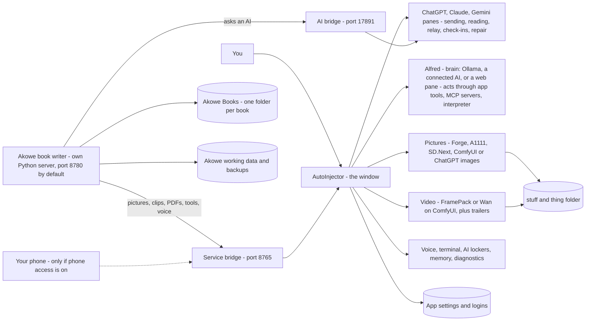

# How AutoInjector works

This page explains how the whole program fits together and what happens behind the buttons. It is not a
button-by-button manual. For that, see [`README.md`](../README.md), [`akowe/README.md`](../akowe/README.md) and
[`docs/ALFRED.md`](ALFRED.md). For what changed and when (and how to undo a change), see
[`PROJECT_HISTORY.md`](PROJECT_HISTORY.md).

## 1. The big picture

AutoInjector is one window on your PC. Inside it, ChatGPT, Claude and Gemini each run in their own pane. These are
the real websites, signed in with your own subscriptions, so there are no API bills. AutoInjector types into those
panes and reads the replies, just as you would. Next to them sits **Akọwe**, the book writer. Akọwe is a small
program on your PC, shown in the 📖 Akọwe tab. When Akọwe needs an AI, it asks AutoInjector through a private
connection called **the bridge**. AutoInjector also drives a picture program (Forge, A1111, SD.Next or ComfyUI,
or ChatGPT's own image maker) and **FramePack** or **Wan** for video, on your own graphics card. **🎩 Alfred** is an
assistant that can press the app's buttons for you. He thinks with a local AI (Ollama), an AI you connect with a
key, or one of the web panes. Pictures, videos, models and logs go into **"stuff and thing"**. Books, Akọwe's own
data and the app's settings each have their own place (see section 6).



The same picture in plain text:

```
YOU
 |
 v
AUTOINJECTOR (the window)
 |
 +-- ChatGPT / Claude / Gemini panes
 |     sending, reading, relay between AIs, queues, House Rules,
 |     prompt sequences, attachments, transcripts, check-ins and repair
 |
 +-- 📖 Akọwe tab --> Akọwe's own Python server (port 8780 by default; 8781-8799 if busy)
 |
 +-- 🎩 Alfred
 |     brain: Ollama, OR an AI you connect with a key, OR a web pane
 |     acts through: the app's own tools, MCP tool servers, the code interpreter
 |
 +-- 🎨 Pictures: Forge / A1111 / SD.Next / ComfyUI, OR ChatGPT's image maker
 |
 +-- 🎬 Video: FramePack, OR Wan on ComfyUI  + trailer assembly
 |
 +-- Voice, terminal, AI lockers, memory, diagnostics
 |
 +-- AI bridge (17891)       <--> Akọwe's AI requests and answers
 |
 +-- Service bridge (8765)   <--> pictures, video, trailers, PDFs, tools, voice,
                                  messages, events, and the phone page

AKỌWE (the book writer)
 |
 +-- Idea, characters, world, plot, outline, chapters
 +-- Book Bible, dossiers, continuity and quality checks
 +-- Reviews, rewrites, approvals, reports, backups
 +-- PDF / EPUB / Word exports and the book.akowe file
```

"Port" just means a numbered door on your own PC. The numbers above are the usual ones, not fixed: if a door
is taken, Akọwe tries the next few (8781–8799), and each door can be set to another number. The doors open only to
your own computer (`127.0.0.1`), never to the internet, unless you turn on **phone access**. That opens the service
bridge to your home Wi-Fi, behind its key.

## 2. The parts

### 🤖 AutoInjector (the window)

- **What it is:** the desktop app you start. Folder: `desktop-app/`.
- **Panes:** each AI's real website, side by side. You sign in once; the sites remember you.
- **Typing and reading:** to send a message, AutoInjector types it into the AI's message box and presses Send.
  Every message starts with a number, `[MSG #n]`. A send only counts when that number shows up in the chat.
- **Tags:** each AI is asked to start its reply with `[TO: …]` (who it is for) and end with `[FROM: …]` (who wrote
  it). The closing tag tells AutoInjector the reply is finished. Then it reads the reply.
- **Relay:** a reply marked `[TO: CLAUDE]` is passed on to Claude, and so on. This lets the AIs talk to each other.
  After 30 hand-offs in a row it pauses until you step in.
- **Check-ins and self-repair:** about every 20 minutes, AutoInjector sends each idle AI a tiny test ("Reply with
  only this word: marigold"). They stay out of the app's conversation and are never passed to the other AIs,
  though you may spot them in that AI's own pane. If the AI fails, AutoInjector works out why and tries to fix it:
  other ways to find the box or the reply, a page reload, pressing Stop on a stuck AI. If an AI was busy with
  something, it is then asked to carry on where it left off.
- **🎯 Point at it and learned selectors:** websites change their layout. A "selector" is the address of a thing on
  the page, such as "the reply box". When the built-in ones stop working, you can click 🎯 and point at the message
  box, the Send button or the reply. AutoInjector saves that per site. **🔢 Do it for me with a number** teaches it
  by watching you type a number. **↺ Forget what I taught** goes back to the built-in ways.
- **Logs and 📋 Extract:** the app keeps an activity log and a record of every message's journey (the Relay
  Trace). Extract turns these into one file you can share. Keys and private paths are removed.

### 🔗 The bridge (how Akọwe asks an AI)

- **What it is:** a small private door inside AutoInjector. Code: `desktop-app/akowe-bridge.js`. Details:
  [`AKOWE_AUTOINJECTOR_BRIDGE.md`](AKOWE_AUTOINJECTOR_BRIDGE.md).
- **Connection key:** like a password, so only your Akọwe can use it. AutoInjector pairs the two by itself.
- **One request, step by step:**
  1. Akọwe sends a request: which AI, the full prompt, and an ID.
  2. AutoInjector types the prompt into that AI's pane, with its `[MSG #n]` number.
  3. It waits for the reply that answers that exact number.
  4. It removes the tags and hands the text back to Akọwe. That reply is never relayed to the other AIs.
  5. Akọwe checks the answer. Most answers must be a tidy block of data (JSON). If not, it asks again, up to two
     more times.
- **When it can't answer:**
  - **Busy:** one request per AI at a time. A second one hears "busy", and Akọwe waits and retries.
  - **Site error:** the site showed its own notice ("Something went wrong", a usage limit). Akọwe waits (30 s, or
    60 s after a usage limit, then longer, up to 2 minutes each and about 10 minutes in all) or uses another AI.
  - **Not working:** an AI that is being repaired, logged out or broken is skipped. Its work goes to another AI.
  - **Timeout:** no answer in time (4 minutes by default). Akọwe never retries this by itself, because the answer
    may still come. The step pauses and you press 🔁 Try again.
- A second door, the **service bridge** (port 8765), does more than the AI bridge. Akọwe uses it for pictures,
  video clips, trailers, the ebook cover JPG and the Book Bible PDF. It also carries the app's tools, voice (speak
  and listen), messages to the AIs, live events, and the phone page.

### 📖 Akọwe (the book writer)

- **What it is:** a Python program that runs on your PC. AutoInjector starts it and shows it in the 📖 tab.
  Folder: `akowe/`. Its working data lives in `%LOCALAPPDATA%\Akowe` on Windows.
- **Records:** every piece of the book is a **record**: a character, a place, the premise, the outline, a chapter.
- **Versions:** a record is never changed in place. Each change makes a new **version**. Old versions stay.
- **Approvals:** a new version starts as a **draft**. It becomes part of the book only when it is **approved**.
- **Canon:** the approved records together are the book's **canon**, the official truth everything else must match.
- **Out of date (stale):** if something a record was built from changes, Akọwe marks that record out of date.
- **AI slots:** AI-1, AI-2 and AI-3. By default they are Claude, ChatGPT and Gemini, through the bridge.

### 🎨 Images

- **What it is:** the 🎨 Images tab. It drives a picture program on your PC: Forge, A1111, SD.Next or ComfyUI.
  AutoInjector can find, start or install one.
- **Engines:** Stable Diffusion (Forge, A1111, SD.Next or ComfyUI), ChatGPT (it draws inside its own pane), or
  Auto.
- **Checkpoint models and LoRAs:** a checkpoint model is the main picture model. A LoRA is a small add-on that
  teaches it one look or style.
- **🔒 Character locks:** a saved recipe (a LoRA, trigger words, fixed looks, or a portrait) that keeps one
  character's face the same in every picture. In a ⚡ run, each character's portrait becomes its lock.
- Pictures are saved in `stuff and thing/images/`, each with a `.json` file of the settings that made it.
- **Tested for real:** pictures have been made with Forge on your PC.

### 🎬 Video

- **What it is:** the 🎬 Video tab. Two engines:
  - **FramePack**, the copy you already have (for example in Stability Matrix). Nothing is downloaded.
  - **Wan** on ComfyUI. Its models download inside the app.
- **Trailers:** shots and title cards joined into one trailer (WebM, plus MP4 when ffmpeg is found). Akọwe's
  🎬 Trailer page plans the shots from the book.
- **Not yet confirmed on your PC:** on your RTX 5070 Ti, four test rounds fixed start-up and loading problems.
  A first finished clip, picture → video, text → video and a trailer still need to be confirmed. Use
  🩺 Test pictures & video (Full).

### 🎩 Alfred

- **What it is:** an assistant in a side panel (Ctrl+Shift+A). He is off until you turn him on.
- **His AI (his "brain"), three choices:** a local model through Ollama (the default; nothing leaves your PC),
  an AI you connect with a key (any OpenAI-compatible service), or one of the ChatGPT / Claude / Gemini panes.
- **Tools:** a fixed list of the app's own controls: books, pictures, video, the panes, files and logs. He cannot
  run any code you have not allowed.
- **"I will…" cards:** before he changes anything, he shows a card saying what he will do. Nothing happens until
  you press ✔ Do it, unless you ticked "always allow" for a harmless tool. Running code and outside tool servers
  never get "always allow". He never approves your chapter drafts. He can approve a Character Forge proposal,
  but only through an "I will" card.
- **Tool servers (MCP):** you can add outside tools (files, a database, a web service). He uses them only through
  an "I will" card, every time.

### 🩺 The self-tests

| Test | Where | What it proves |
|---|---|---|
| 🩺 Check everything | Alfred | his AI, disk, Stable Diffusion, Akọwe, the panes, the logs; with Fix buttons |
| 🩺 Test pictures & video | 🎬 Video or 🎨 Images | Quick: everything is reachable. Full: one picture, one clip, a tiny trailer |
| 🧪 Test the connection | Akọwe panel | the bridge, the key, and a real question to each AI |
| 🩺 Check now | AI cards | a check-in for each AI |
| Run relay check | Tools menu | the AIs pass a list round; shows where messages get lost |
| 🧪 Test workflow, Test everything | Akọwe (Advanced view) | Akọwe's own steps, end to end |

## 3. What happens when you press ⚡ Make a book

Pressing Start is your **consent for this run only**. The run makes a brand-new book; your other books are never
touched. It works in the background, so you can close the window. First, AutoInjector checks in with every AI (up
to a minute), so the run knows which AIs work.

1. **Safety backup** of all your books.
2. **Invent the book:** title, pen name, genre, readers, tone and the idea. The point of view (first or third
   person) and the tense (past or present) are fixed here too, from your choice, else the AI's pick for this
   story, else the genre's usual.
3. **Characters and places:** drafted, reviewed, approved. The main character (★) is guaranteed to exist.
4. **Character sheets and voices:** what each character wants, needs, fears and hides, and a **voice card** for
   how each one talks.
5. **Looks and voice details:** only the essentials (height, face, hair, clothes…). Everything else waits.
6. **Character pictures:** a portrait each, made with Stable Diffusion; each becomes that character's 🔒 lock.
   This never holds up the book.
7. **Story rules and world texture:** what is law in this world, what is only believed, and real-world obstacles.
8. **Premise**, then **main plot**, then **chapter outline**. If you picked a **story shape** (Three acts, Save the
   Cat, Hero's Journey or Seven-point), the outline is planned on it and each of its beats is placed on a chapter
   (shown as "Ch 22 · Dark night of the soul" on the plan page and in the Book Bible); a beat the AI leaves out or
   misplaces goes where it usually falls in a book.
   - **Optional: fill the whole Book Bible** from the plan before chapter one. It is off unless you turn it on
     (on the start screen, or 📖 Book Bible → At a glance). It never holds up the book.
9. **Every chapter.** For each one:
   - **Just-in-time details:** if the chapter has a fight, the fighters' style and weapon are decided now. A new
     place gets its rooms, sounds and smells. Once a chapter uses a detail, it is **locked**.
   - **Scene cards:** the writer plans the scenes. A different AI checks them. With the scene cards the planner
     also writes the chapter's **needs list** 🧠: exactly which Book Bible sections it needs, by code
     (`Chapter 7 needs: Mara C11, C44 · Brass key I22 · Notes N11(Mara) · Earlier: chapter 3 (…)`). Akọwe checks the
     codes, and gives the writer just those sections, a short quote of each earlier moment, and only the running
     notes asked for — nothing missing, nothing extra. An empty section on the list is filled just in time first.
     Older plans without a list keep the old way (Akọwe guesses from the plan's words).
   - **Writing:** the writer gets the plan, the voice cards, the locked details, the end of the last chapter, the
     story so far, and your promises to the reader: content limits, themes, the central question, the point of
     view and tense. If the instructions are too long, the least important parts are cut first, and the run shows
     ⚠️ with exactly what was cut.
   - **Akọwe's own checks**, then an **independent reviewer** (a different AI). If it asks for changes, the writer
     fixes the draft, at most twice. A chapter that breaks your content limits, or switches person or tense, is
     always sent back.
   - **The editor** reads it for craft and asks for rewrites of exact passages, at most two rounds. A rewrite is
     kept only if nothing got worse.
   - **Planned-to-page check:** did the plan really reach the page? At most one targeted fix. With a story shape,
     the chapter's beat is part of the plan: the scene cards, the writer and the reviewer are told "this chapter must
     deliver …", and the checkpoints and the ending check list any beat that did not land (one targeted fix).
   - **Approved** under your run consent. Then the **running notes (ledgers)** are updated: injuries, belongings,
     who is where, the day and season, who knows which secret, names, money.
   - **Every 5 chapters** (you can change this), at each act's end, and after the last chapter: a **continuity
     checkpoint** reads those chapters in full and fixes small mistakes. It also looks for side characters who
     vanished and story threads that should have moved by now.
   - **The ending check**, after the last chapter: does every setup pay off, does every named character get an
     ending, does the main character change, does the ending answer the book's question? What is still open is
     fixed in the last chapter(s) (one round), checked again, and anything left is listed for you.
10. **Planned details on the page:** a whole-book report.
11. **Book format**, **put the book together**, **export PDF, EPUB and Word**. Each file is re-read by Akọwe's
    export check to make sure nothing was lost.
12. **Content check** (every chapter once, in order) and the **book report**. An optional **beta reader** step
    reads the book as its target reader.

**Where it stops for you:**

- The reviewer still says no after two fixes. You choose:
  - **✔ Approve anyway:** your own approval.
  - **✏️ Edit it myself**, then Continue.
  - **🔁 Try again:** two more AI fixes.
- Only one AI is working, so nobody else could check a draft. You choose: **✔ Approve it yourself** (read it
  first), or **🔁 Try again** once another AI is connected.
- An AI did not answer in time.
- A checkpoint found a problem it could not fix safely (once per checkpoint).
- Akọwe was closed mid-run. The run shows **Interrupted** and **▶ Resume** carries on.

**⏸ Pause** stops after the current piece of work. **▶ Resume** continues exactly where it stopped.
**✖ Cancel** ends the run; what is done is kept.

## 4. How quality is kept

| Check | What it catches | When it runs |
|---|---|---|
| Akọwe's own checks | missing parts, wrong IDs, an outline without the main character | every draft |
| Independent reviewer | a draft that does not fit the plan or the canon | every draft |
| No self-approval | an AI approving its own writing, or approving with no reason | every approval |
| Your promises (content limits, themes, question) | a chapter showing what you ruled out | writer, reviewer and editor, every chapter |
| Point of view and tense | a chapter that slips into another person or tense | every chapter |
| Editor rubric | told-not-shown feelings, flat side characters, same-sounding voices, no stakes | every chapter |
| Timeline arithmetic (no AI) | ages and years that don't add up ("twelve, twenty years ago… now forty") | the whole-book fact check, near the end |
| Readability (no AI) | prose too hard or too simple for the book's readers | the book report and the scene grid |
| Pattern check (no AI) | repeated habits ("went very still"), lists of three, same-length sentences | before the editor |
| Voice cards | characters who all talk alike | writing and editing |
| Locked details | eyes, hair, weapon or weapon hand changing | after each chapter |
| Running notes (ledgers) | a healed limp, a lost knife drawn again, the dead speaking, misspelled names, wrong travel times | after each chapter |
| Hand-edit follow-through | later chapters still built on what you edited away | when a changed chapter is approved again |
| Continuity checkpoints | anything the notes missed, read in full | every N chapters and at the end |
| Ending check | setups that never pay off, vanished side characters, an ending that misses the question | at checkpoints (light) and after the last chapter |
| Protagonist guarantee | a book that loses its main character | before the outline, the chapters and "done" |
| Cut instructions ⚠️ | the writer silently missing facts, rules or voice cards | every chapter |
| Needs list 🧠 | a listed detail that does not match the page (named by its code, e.g. "Mara C1c (eyes)"); things used but not planned | reviewer and checkpoints, every chapter |
| Final checks and export check | chapters missing or doubled; scores and weaknesses; a PDF, EPUB or Word file that lost text or is broken | at the end |

A few of these need more words:

- **No self-approval.** An AI's "approve" only approves a draft when a *different* AI reviewed it, gave at least
  one reason, and was at least 60% sure. Otherwise the draft waits for you. Two panes on the same website count
  as the same AI.
- **Approved without checks.** "Approve anyway", "approve it yourself" and the standing auto-approve skip some
  checks. Each such approval is written down. The editor and the plan check still run as notes. The book report
  and a ⚠️ *Needs a look* card on 🏠 Book home list these chapters.
- **Hand edits.** When you change a chapter, what Akọwe read from the old text is set aside: its running notes,
  the notes of every later chapter (they were built on top of it), its lines in the story so far, and any
  checkpoint that read it. They are read again from the new text, and
  each later chapter gets a flag: *"Chapter 5 changed after chapter 6 was written — check chapter 6."*
- **Needs lists.** The chapter reviewer and the checkpoints get each chapter's needs list and check every listed
  section on the page. When the chapter used something its list did not plan, the run says so ("🧠 Chapter 7 also
  used Tom Reed (not planned)") and the next plans learn from it. ⏱ Time and AI use shows how much smaller the
  writer's instructions were ("Smart memory saved ~N% of instruction size").
- **Book report.** For a long book the report says when it only read a sample. **📖 Read the whole book** reads
  every part.

**Other things that are kept in step:** a sequel first finds what changed in book 1. Pictures and face locks
are marked out of date when the description they came from changes, and so is the trailer when the book or the
looks change. The blurb and cover are compared with the book, and the cover follows a new title. Accented letters
(ọ, ẹ, Greek…) are checked when a chapter is approved and get a font that has them; the files use the book's
language. If one file fails to save, the old one is renamed "(older version)" so it is never mistaken for the new
one. Alfred acts on the run of the book that is open. Replies that look cut off are not taken as finished.

**Honest limits (checked against the code):**

- **✍ Write all chapters**, used outside a ⚡ run, still skips the just-in-time details, the checkpoints and the
  ending check. It also plans missing scene cards without the second AI's check.
- The point-of-view and tense check counts pronouns and verbs outside dialogue. It catches a clear switch, not a
  subtle one.
- A rename like "Bram" → "Brannock" (not a near-miss spelling) is left to the checkpoint AI. Akọwe's own keyword
  reading is English only.
- Locked-detail checks cover colours, an item's metal, weapons and the weapon hand only. The AI checks the rest.
- Everything here has been tested with stand-in AIs. Real books with the real websites are the real test.
- Video is not yet confirmed on your RTX 5070 Ti (see 🎬 Video above).

## 5. The Book Bible and series

**The Book Bible** is a binder of your whole book, one page per thing. It has 12 page templates: At a glance, the
cast, a page per character, the relationship map, places, magic and items, the map, the story plan, a page per
chapter, and rules and facts. One of 7 looks is picked from the genre.

It fills up in three ways:

- **Before writing:** from the characters, places and plan.
- **While writing:** just-in-time details and locked facts are added as the chapters need them.
- **✨ Fill from the book:** the AI reads the book and proposes missing small facts. You approve each one.

You can download it as **⬇ PDF** or **⬇ Word**. Each save also puts it in the book's `Book Bible/` folder.

**Series.** Each character, place, item and group has two layers:

- **Fixed across the series:** name, identity, personality, origin, voice card. A sequel never changes these.
- **Changes per book:** looks, belongings, powers, relationships, status (alive, injured…), a place's ruler or
  condition.

Before a sequel, **✨ Find what changed in this book** reads book 1. It proposes those changes for you to approve. The sequel
then carries the locked facts, belongings, status and a summary of book 1.

## 6. Where everything is saved

| What | Where |
|---|---|
| Pictures, videos, trailers | `stuff and thing/images/`, `videos/` (trailers in `videos/trailers/`) |
| Models (checkpoints, LoRAs, FramePack, Ollama…) | `stuff and thing/models/` (one folder per kind) |
| Installed programs (ComfyUI, Ollama) | `stuff and thing/apps/` |
| Reports and test results | `stuff and thing/logs/` |
| Your books | `Documents\Akowe Books\` (change it in Akọwe → Settings → 📁 Where books are saved) |
| Akọwe's working data and backups | `%LOCALAPPDATA%\Akowe` |
| AutoInjector settings, transcript, connection key | `%APPDATA%\autoinjector-desktop\` |

**Inside one book's folder:** `Book/` (PDF, EPUB, Word), `Chapters/`, `Book Bible/`, `Reports/`, `Log/` (the
journal), `Progress/`, `Cover/`, `Pictures/`, `Character Forge/`, `Trailer/`, and **`book.akowe`**. That last file
is the whole book in one file, for opening it again, even on another PC. Akọwe saves after every run step, and
quietly every 10 minutes when a book has changed.

**What is private:**

- Your book's text **is** sent to the AI websites you use. That is how they write it.
- Connection keys and passwords are never logged, never put in the book folder, never given to an AI.
- Logs and journals hold what happened (step, AI, time, result), not your prompts or replies.
- Alfred on Ollama runs entirely on your PC.

## 7. When something goes wrong

- **An AI stops answering:** self-repair tries first. If it cannot fix it, it tells you once. Press
  **🎯 Point at it** or **🔢 Do it for me with a number**.
- **Logged out, "are you human?", usage limit:** the AI's card shows **⚠️ Needs you**. Fix it in the pane.
  AutoInjector notices by itself. Meanwhile, Akọwe sends the work to the other AIs.
- **A book run pauses with ⚠️:** read the message on that step. It says what to press.
- **Pictures or video fail:** run **🩺 Test pictures & video**. Each ❌ says what to try.
- **Not sure what's wrong:** Alfred's **🩺 Check everything**.
- **To share a log:** **📋 Extract** → **Last 24 hours**. Never choose **Everything**: it includes all your older,
  private conversations.

## 8. Glossary

| Word | Meaning |
|---|---|
| Pane | one AI website inside the window |
| Bridge | the private door Akọwe uses to ask an AI a question |
| Service bridge | the second door, for pictures, clips and PDFs |
| Connection key | a password between Akọwe and AutoInjector; never leaves your PC |
| Relay | passing one AI's reply on to another |
| Tags | `[TO: …]` and `[FROM: …]` around each reply: who it is for, who wrote it |
| Check-in | a tiny hidden test message to see that an AI still answers |
| Self-repair | AutoInjector fixing its own way of reading a site |
| Selector | the "address" of a box or button on a web page |
| Record | one piece of the book: a character, the outline, a chapter |
| Version | one saved state of a record; changes make new versions |
| Draft | a version not yet approved |
| Approve | accept a version as part of the book |
| Approve anyway | your own approval when the AI reviewer said no |
| Canon | everything approved: the book's official truth |
| Stale (out of date) | built from something that has since changed |
| Run | one ⚡ Make a book from start to finish |
| Consent | pressing Start lets the run approve drafts, for that run only |
| Reviewer | the AI that checks a draft; a different AI from the writer when possible |
| Editor | the AI that reads a chapter for craft and asks for rewrites |
| Voice card | how one character talks: rhythm, favourite words, words they never use |
| Locked detail (🔒) | a fact a chapter has used, which later chapters must keep |
| Ledger | running notes: injuries, belongings, places, days, secrets, money |
| Continuity checkpoint | a full reread of recent chapters to catch and fix mistakes |
| Checkpoint model | a Stable Diffusion main picture model (nothing to do with continuity checkpoints) |
| LoRA | a small add-on to a picture model for one look or style |
| Character lock | a saved recipe that keeps a character's face the same |
| Book Bible | the binder of the whole book, one page per thing |
| MCP tool server | an outside tool Alfred can use, always after an "I will" card |
| "stuff and thing" | the app's folder for pictures, videos, models, installed programs and logs (books and settings live elsewhere) |
